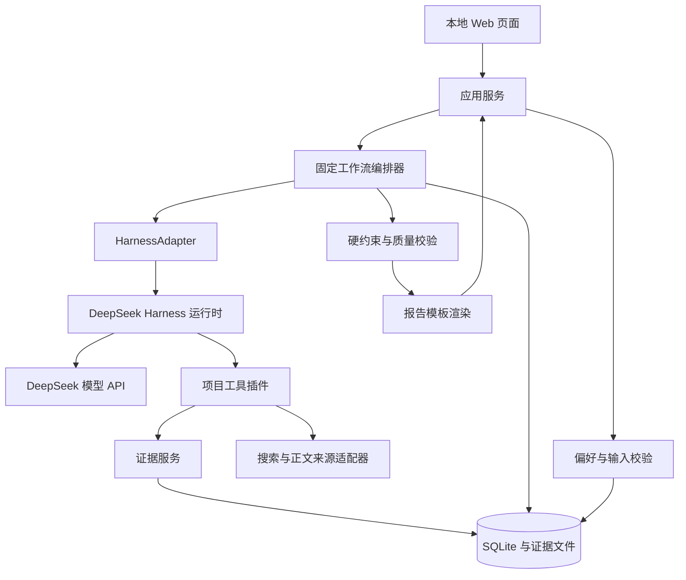

# 个人信息收集与处理助理：基于 DeepSeek Harness 的 Agent 技术方案

版本：v0.1（评审稿）  
日期：2026-10-15  
需求基线：[需求.md](./需求.md)  
状态：历史设计稿。2026-10-20 已追加第 15 节并验证独立 headless CLI 模型连通，当前 Harness 使用方式以该追加节为准；完整项目采用与交付尚未通过。原稿中的业务模块、工具名称、接口和预算是项目拟定设计，不代表 Harness 已内置这些能力。

## 1. 技术决策概要

首期采用 **TypeScript + DeepSeek Harness + 本地 Web 界面 + SQLite**，实现个人使用的信息收集助理。首个工作流为“已确定目的地的旅游信息探索”。

执行结构采用**固定阶段编排、阶段内受限 Agent、结构化证据、确定性约束校验**：

- 代码决定阶段顺序、工具权限、硬约束、执行预算和任务终态。
- Agent 负责阶段内的搜索词调整、网页内容提取、偏好匹配及有依据的解释。
- 外部事实先进入证据库，再进入候选项与报告；搜索摘要只作为发现线索。
- 一个任务按阶段串行运行，首期不引入多 Agent 协作、工作流自动生成或长期自动探索。
- 本次输入、默认偏好、工作流默认值分别留痕，避免把模型假设当成用户要求。

选择这一结构，是因为首期核心验收是重复执行、遵守约束、来源可查与异常可见。通用自主规划会增加不可控分支，不能代替这些业务规则。

## 2. DeepSeek Harness 的定位与接入边界

### 2.1 已核实的框架基础

DeepSeek Harness（`dsh`）是 DeepSeek 官方开源 Agent Harness，采用 Cordis 插件架构，仍处于开发者预览期，官方明确提示可能发生不兼容变更。[官方仓库](https://github.com/deepseek-ai/deepseek-harness)

当前架构文档提供模型、工具、Agent 循环和会话等扩展点，并提供 SDK profile。项目拟通过官方 SDK 路径启动运行时，通过独立插件接入业务工具；不修改框架核心循环。[架构文档](https://github.com/deepseek-ai/deepseek-harness/blob/master/docs/architecture.md)

自定义工具参考官方 `defineTool`、`ctx.tools.register` 接入方式，遵守结构化返回值与取消信号约定。框架的参数校验不能替代项目的范围、额度与业务约束校验。[工具开发文档](https://github.com/deepseek-ai/deepseek-harness/blob/master/docs/cookbook/adding-a-tool.md)

### 2.2 复用能力与自建能力

| 层次 | 使用方式 | 项目责任 |
|---|---|---|
| 模型调用、工具调用循环 | 复用 Harness，并封装运行时适配层 | 模型配置、错误映射、结构化产出校验 |
| 插件生命周期、工具注册 | 使用 Cordis / Harness 扩展点 | 收集工具、证据工具、权限与预算策略 |
| 会话与运行事件 | 复用框架机制 | 映射业务任务、脱敏、生命周期管理 |
| 固定工作流 | 自建业务编排器 | 阶段顺序、阶段完成条件、补查规则 |
| 偏好和硬约束 | 自建领域模块 | 显式保存、优先级、三态筛选 |
| 信息来源与证据 | 自建来源适配器与证据库 | 原文读取、时效、引用绑定、冲突记录 |
| 产品界面和任务状态 | 自建轻量 Web 页面 | 表单、阶段进度、报告、失败反馈 |

### 2.3 接入方式

应用服务通过 `HarnessAdapter` 调用官方 TypeScript SDK，由其启动匹配版本的 `dsh` 运行时。运行时挂载本项目插件，提供阶段所需的工具集合。首期每个阶段使用独立会话，由编排器传入经过验证的任务快照和上游结构化产物。

采用独立阶段会话的目的，是控制上下文长度并隔离工具权限；它们属于同一条串行工作流，不组成自主分工的 Agent 团队。

`HarnessAdapter` 对业务仅暴露以下拟定接口：

```ts
interface HarnessAdapter {
  runStage(request: StageRequest, signal: AbortSignal): Promise<StageResult>;
  stopTask(taskId: string): Promise<void>;
}
```

这不是官方 SDK 签名。阶段运行、停止和事件订阅的实际映射在接入验证中确认；不能把本文伪接口直接作为可执行配置。

版本策略：实现前锁定通过验证的发行版本或 commit、SDK 版本、插件版本及依赖锁文件，在每次任务记录中保存版本指纹。升级必须重新跑工具调用、停止、阶段结果和引用链回归用例。

## 3. 首期范围与技术栈

| 项目 | 首期建议 | 选择依据 |
|---|---|---|
| 语言与运行环境 | TypeScript、Node.js 24、pnpm | 与 Harness 接入保持同一语言，减少跨语言边界 |
| Agent 运行时 | DeepSeek Harness，锁定验证版本 | 复用 Agent 循环和插件机制 |
| 模型 | DeepSeek API，模型 ID 配置化 | 根据账号可用模型与样例测评确定默认模型 |
| 页面 | React + Vite | 少量表单、进度与报告页面 |
| 应用服务 | Fastify | 提供任务、偏好和报告 API |
| 数据校验 | Zod，必要时生成 JSON Schema | 输入、阶段产物和报告共享类型定义 |
| 存储 | SQLite + 本地证据文件 | 单用户、单机部署，便于备份与检查 |
| 信息读取 | 搜索服务适配器 + HTTP 正文读取 | 先验证公开网页覆盖能力 |
| 动态网页 | 预留 Playwright 读取适配器 | 仅在首个工作流确实依赖时纳入实现 |
| 任务执行 | 应用内单任务调度 + 独立 Harness 进程 | 控制首期并发与部署复杂度 |
| 状态通知 | SSE，轮询兜底 | 展示阶段变化，不暴露内部推理 |
| 验证 | Vitest + 固定网页样本 + 少量真实端到端用例 | 分离可重复规则测试与外部来源波动 |

以上为工程选型建议，尚未在当前项目安装验证。官方当前开发指南支持 Node.js 24，也允许 Windows 原生开发；首期按当前 Windows 环境验证，不将 WSL 作为必需条件。[开发指南](https://github.com/deepseek-ai/deepseek-harness/blob/master/docs/development.md)

首期不引入 Redis、向量数据库、分布式队列或通用工作流编辑器。不提供预订、支付、投递、消息发送工具。持久化当前任务用于结果交付与异常恢复识别，历史任务检索产品功能、自动续跑和定时执行不在首期范围。

## 4. 系统结构



业务编排器掌握任务状态的最终写入权。Agent 可以提交结构化阶段结果，不能自行把任务标为完成、修改偏好、调整硬约束或提升预算。

工具插件通过只对本机开放、带运行令牌的内部服务访问证据和任务预算。这样由应用服务统一执行 SQLite 写入与预算扣减，避免应用与运行时各自维护一份不一致的业务状态。任务身份来自执行上下文，不接受模型传入任意任务 ID。

## 5. 固定工作流设计

### 5.1 定义方式

每个预设工作流由版本化的 TypeScript 定义和提示模板组成。定义至少包含：输入 Schema、默认值、适用偏好字段、允许来源、阶段列表、硬约束规则、排序规则、输出 Schema、预算及完成条件。

首期使用代码注册的有限工作流，不执行用户提交的任意流程脚本。增加一个领域工作流，主要增加 Schema、领域规则、提示模板和报告模板。

### 5.2 阶段及责任

| 阶段 | 执行者 | 主要行为 | 完成条件 |
|---|---|---|---|
| 输入检查 | 代码 | 合并默认偏好，检查必填和冲突 | 输入有效且所有假设可见 |
| 查询准备 | Agent + 校验器 | 根据目标生成有限搜索计划 | 搜索范围、数量、类别符合定义 |
| 搜集候选 | 受限 Agent | 搜索、读取原文、登记候选 | 达到候选上限或发现预算耗尽 |
| 关键条件核查 | 受限 Agent | 对交通、开放、预约等补充证据 | 每项必要条件有证据或明确缺口 |
| 提取与整理 | Agent + 代码 | 提取主张、去重、标记冲突 | 输出结构合法，引用可定位 |
| 筛选与排序 | 代码 + Agent 解释 | 三态硬约束筛选，软偏好排序 | 合格、待确认、排除三类分离 |
| 报告生成 | Agent 文案 + 模板 | 生成推荐理由和注意事项 | 文案主张受证据约束 |
| 交付检查 | 代码 | 引用、硬约束、必需栏目检查 | 输出完整、部分或无匹配结果 |

正常流程固定向前推进。只有核查或交付检查发现具体缺口时，允许回到核查阶段一次；补查仍消耗同一任务预算。格式修复也受总模型调用上限约束，不形成无限自我反思循环。

### 5.3 旅游工作流输入

建议 `travel.destination.v1` 的基础必填项为目的地、日期或时间范围、可用天数、交通方式。预算允许用户明确选择“不作为筛选条件”；一旦填写硬预算，必须明确币种、每人或总额、包含门票/市内交通等哪些支出。

偏好包括体验类型、人群容忍度、步行强度与节奏。“希望避开拥挤”默认是软偏好；用户明确指定的可测限制才能作为硬约束。不将“安静”“轻松”等描述转换成未经确认的数值阈值。

周边探索默认关闭，并在执行前展示；开启后必须提供单程交通时间上限。若要核查交通时间，还需明确市内出发参考点，可采用页面展示的“目的地主要交通枢纽”默认值。没有参考点的精确交通时间不能作为已验证事实。

针对大致月份而非精确日期，只能判断季节性条件；具体日期的开放、预约状态可能仍待确认。输出是游玩候选与比较，不默认升级为完整行程排程或包含住宿大交通的旅行预算优化。

## 6. 工具与信息来源

### 6.1 拟定工具集合

| 工具 | 输入要点 | 返回要点 | 阶段 |
|---|---|---|---|
| `search_web` | 查询词、限定范围、结果上限 | URL、标题、摘要、服务返回时间 | 查询、搜集、核查 |
| `read_page` | 已发现 URL | 来源 ID、正文片段、时间、抓取状态 | 搜集、核查 |
| `read_evidence` | 本任务证据 ID | 已保存原文片段和元数据 | 提取、生成 |
| `submit_candidates` | 候选结构化数据 | 校验结果、候选 ID | 搜集 |
| `submit_claims` | 主张及其证据引用 | 引用与结构校验结果 | 提取、核查 |
| `submit_stage_result` | 本阶段规定的结构 | 校验结果与缺失字段 | 各模型阶段 |

保存证据是 `read_page` 的服务端副作用；来源 URL、抓取时间与证据 ID 由代码写入，模型不能自由编造这些字段。工作流推进、偏好写入和报告终态均不开放为模型自由调用工具。

### 6.2 来源策略

首期支持公开可读取网页：景区或场馆官网、政府文旅页面、交通运营方页面，以及用来发现体验和评价的公开攻略文章。来源类型是优先级策略，不等于已经接通所有网站。

来源优先级按信息类型区分：开放和预约优先官方公告；公共交通优先运营方或授权路线接口；拥挤与体验评价允许使用近期公开游记，但保留作者观点和时间，不能据此承诺现场人少。

搜索供应商尚未选定。P0 用相同中文旅游查询集评估候选服务的有效链接、官方页面覆盖、可读率、费用和限流，再选一个正式接入。业务只依赖统一 `SearchProvider` 接口。未配置有效搜索服务时明确报错，不能以模型记忆模拟联网完成。

读取失败的处理顺序为：有限重试 → 其他来源 → 标记缺口。JS 页面确实必要时再增加浏览器读取。首期不依赖登录态平台，不尝试绕过验证码或访问限制。

### 6.3 时效与冲突

建议初始策略：开放/预约/票价/交通优先本次重新读取，跨任务缓存最长 24 小时；一般体验介绍可缓存 7 天。这是缓存策略，不能把“刚抓取的旧公告”判为最新规则。

每条证据独立记录抓取时间、可获取的发布时间、适用日期区间与时间是否未知。日期未知、适用时间不符或来源冲突时，相关条件降为待确认。官方信息也必须匹配地点、对象和出行日期。

## 7. 证据、约束和排序

### 7.1 数据链

```text
Source（来源身份）
  → Evidence（本次抓取的原文片段）
    → Claim（事实 / 来源评价 / 系统推断）
      → ConstraintCheck（通过 / 不通过 / 未知）
        → Candidate（合格 / 排除 / 待确认）
          → ReportItem（展示内容及引用）
```

证据记录包括最终 URL、来源名称、抓取时间、内容摘要或哈希、片段定位、正文截断标记、可用的发布与适用时间。搜索摘要不能自动升级为已核查原文。

每个事实主张至少绑定一个可定位片段；评价注明来源主体；推断引用依据的事实或评价，并显示“推断/估算”。报告中的 URL 从证据库生成，不让模型直接拼接引用链接。

引用存在只证明可追溯，不证明语义必然正确。代码负责 ID、片段和日期等可校验部分；模型提取必须返回支持片段；验收时人工抽查片段是否真正支持结论。存在实质疑问时降级为未知。

### 7.2 硬约束

每条硬约束返回 `pass | fail | unknown`，并附规则 ID、证据 ID 和原因：

- 任一硬约束 `fail`：进入排除项，不能进入合格推荐。
- 没有 `fail`，但至少一个关键硬约束 `unknown`：进入待确认项。
- 所有适用硬约束均 `pass`：进入合格推荐。
- 没有合格项：交付“未找到符合条件的结果”，保留待确认项供用户核查，不降低约束。

例如“不自驾”需要证据支持适用的非自驾交通方案。路线未知时不能因地点位于目的地附近就判断可达。周边单程上限未知也不能默认通过。

硬预算只有在范围和必要费用均明确时才能通过；缺少某项必要费用时是未知。候选级费用与整趟旅程总费用分开，不用单个项目便宜推导总预算符合。

### 7.3 软偏好排序

首期按工作流定义的少量维度评分：体验匹配、交通便利、步行/节奏适配、拥挤风险。权重来自显式偏好和展示的工作流默认值，分数归一到 0–1，保留每项理由与证据。

```text
偏好分 = Σ（权重 × 维度匹配分）/ Σ（权重）
```

未知维度不赋予正向优势，使用保守默认分并显示证据缺口；该默认值是排序配置，不表示事实已确认。合格项和待确认项分别排序，不能用高偏好分抵消硬约束未知或不通过。

## 8. 偏好管理与数据存储

### 8.1 偏好优先级

采用字段级合并：本次明确填写值 > 已保存且与当前工作流相关的偏好 > 展示的工作流默认值。显式清空必须区分于“未填写”，避免清空后又被默认偏好填回。

任务开始时保存不可变输入快照，标注每项来自本次输入、已保存偏好或默认值。任务输入变更不会自动更新长期偏好；长期保存通过独立界面操作。删除偏好后，新任务不得读取旧值；已经运行的任务按当时快照解释结果。

### 8.2 最小数据模型

| 数据表 | 主要字段与用途 |
|---|---|
| `preferences` | key、value、scope、updated_at；显式偏好 |
| `tasks` | workflow/version、input_snapshot、status、stage、deadline、budget、error |
| `stage_runs` | task_id、stage、session_id、attempt、artifact、usage |
| `sources` | 原始 URL、最终 URL、名称、来源类型 |
| `evidence` | task_id、source_id、fetched_at、published_at、valid_period、content_hash、excerpt |
| `claims` | candidate_id、kind、value、evidence_refs、verification_state |
| `candidates` | task_id、领域字段、constraint_checks、eligibility、ranking |
| `reports` | task_id、report_schema_version、structured_result、rendered_content |
| `task_events` | task_id、seq、阶段事件、时间、可展示摘要 |

业务库是任务状态与报告的权威来源；Harness 会话记录用于运行上下文和排障，以 session_id 关联，不能直接作为面向用户的任务状态。

业务日志只记录工具动作、阶段结果、错误、用量和决策摘要。模型协议可能要求保留推理字段以继续工具调用：按官方协议在运行时传递，不显示为产品执行记录。框架会话自身可能包含相关内容，P0 必须检查实际落盘行为，设置本地访问范围与保留期，不能宣称默认完全不落盘。[DeepSeek Thinking Mode](https://api-docs.deepseek.com/guides/thinking_mode/)

## 9. 任务状态、预算与失败处理

### 9.1 状态模型

```text
等待补充输入 → 排队 → 运行中 → 完成 / 部分完成 / 失败
```

阶段独立于状态记录，如“搜集”“核查”“整理”“生成”。“无匹配结果”属于成功执行后的结果类型；因失败或预算耗尽留下未完成检查时属于部分完成，二者不能混淆。

只有规定检查执行完毕、结果通过交付校验，才能标为完成。部分完成必须携带未完成阶段、失败来源、条件缺口与停止原因。没有任何可交付产物时为失败。

### 9.2 初始预算建议

| 项目 | 初始值 |
|---|---|
| 总时长 | 8 分钟，其中最后 60 秒保留给校验和交付 |
| 搜索调用 | 最多 10 次 |
| 正文读取 | 最多 24 次，每页最多提取约 20,000 字符并标注截断 |
| 候选数 / 推荐数 | 最多 15 个候选，目标 5–8 个合格项，允许不足 |
| 模型请求 | 最多 16 次，包括修复与重试 |
| 模型累计 token | 初始累计上限 100,000，按供应商用量口径统计 |
| 单次搜索/读取超时 | 20 秒 |
| 单次模型超时 | 90 秒，且不能超过剩余任务期限 |
| 工具并发 | 最多 3，单站点另有限流 |
| 失败重试 | 同一请求最多额外重试 1 次，仍计入总预算 |

这些是待测的工程默认值，不是实测性能或费用承诺。所有模型阶段、工具、修复请求共用一个预算账本；服务在发起调用前原子预留额度，收到结果后结算。不能只靠提示词限制次数。

模型费用按输入、缓存输入、输出及供应商计费口径估算，搜索费用另计；费率版本随任务保存。P0 实测后设定单任务金额上限。上线配置必须具备有效上限，不能把未知费用显示为零。

### 9.3 失败收敛

- 429、临时网络故障：在剩余预算内有限退避重试。
- 参数或权限错误：直接记录原因，不重复无效调用。
- 网页失败：继续其他来源，报告中显示影响的字段。
- 模型结构错误：最多一次定向修复；仍失败则使用已验证数据生成模板报告。
- 达到搜集期限：停止新增检索，以已验证数据交付部分结果。
- 达到总期限：取消所有在途请求并输出确定性兜底报告，不再依赖模型完成收尾。
- Harness 进程无响应：先取消，超过短清理期限后终止本任务拥有的进程；任务写入终态。
- 应用重启：将遗留运行任务标为中断失败，保留已有产物并允许重新发起，不自动续跑。

独立 watchdog 依据 deadline/心跳检查任务，不能只等待模型自然返回。终态写入采用条件更新，防止超时与正常完成竞争导致报告状态反复变化。

## 10. 界面与应用接口

界面提供四部分：工作流说明、任务与偏好表单、阶段进度、结果报告。执行前展示采用的硬约束与默认值；结果中将“推荐”“待确认”“排除及原因”“来源与缺口”明确分区。

拟定应用接口如下，均为本项目 API：

| 接口 | 用途 |
|---|---|
| `GET /api/workflows` | 工作流用途、输入和预期产出 |
| `GET/PUT/DELETE /api/preferences` | 读取、显式修改及删除偏好 |
| `POST /api/tasks/validate` | 返回缺失字段、冲突及有效输入预览 |
| `POST /api/tasks` | 再次校验后创建任务，支持提交幂等键 |
| `GET /api/tasks/:id` | 阶段、终态、失败和预算摘要 |
| `GET /api/tasks/:id/events` | SSE 阶段事件，支持序号重连 |
| `GET /api/tasks/:id/report` | 获取结构化报告与来源 |

SSE 断开不取消任务；重新进入页面先读任务快照，再从最后事件序号继续。首期只允许一个活跃任务，超额请求明确提示等待，避免无界队列。

## 11. 执行边界与数据保护

系统只绑定本机地址，页面写操作校验来源并使用会话令牌；模型密钥与搜索密钥只留在服务端，不进入网页脚本、模型提示或业务日志。

网页内容作为不可信材料处理，页面中的“忽略原指令”“读取密钥”等文本不能改变工作流、工具权限和用户目标。首期不挂载模型可用的 shell、任意文件访问、插件安装或代码执行工具。P0 检查实际启动后的工具清单，不能只假设基础 profile 足够受限。

网页读取限制 HTTP/HTTPS，拦截本机、内网和云元数据地址；对 DNS 解析与重定向逐跳校验，限制响应大小、超时与内容类型。报告对网页 HTML 和模型文本转义，链接采用安全协议白名单。

保存与报告相关的必要证据片段和内容哈希；完整正文作为有限期缓存。隐私偏好仅把当前任务必要部分传给模型，搜索词不包含无关个人信息。

## 12. 目录组织建议

```text
spiderAgent/
  需求.md
  技术方案-DeepSeek-Harness.md
  apps/
    web/                       # 表单、进度、报告
    server/                    # API、调度、watchdog
  packages/
    domain/                    # 任务、偏好、证据、约束类型
    workflows/travel/          # 工作流定义、模板和领域规则
    harness-adapter/            # SDK 生命周期、阶段调用与事件映射
    harness-plugins/            # 工具注册与范围策略
    source-adapters/            # 搜索和网页正文读取
    storage/                   # SQLite、迁移、证据存储
    report/                    # Schema、引用校验、模板渲染
  tests/
    fixtures/                  # 固定网页与失败样本
    acceptance/                # 需求验收场景
  data/                        # 本机运行数据，不入版本库
```

领域规则不直接依赖 Harness 类型。未来替换模型或调整 Harness 接入时，证据链、偏好、筛选与报告逻辑保持独立。

## 13. 验证与需求追踪

| 需求 | 验证方式 |
|---|---|
| F01 工作流选择 | 同一版本以至少 3 组不同目的地/时间输入执行 |
| F02 必要输入 | 缺目的地、时间或交通方式时不发起任何依赖调用 |
| F03 偏好 | 本次覆盖默认；显式清空；删除后新任务不使用旧偏好 |
| F04 信息搜集 | 关键事实均可定位原文；搜索摘要不冒充核查；网页失败可见 |
| F05 筛选整理 | fail 不混入推荐；unknown 单独展示；冲突和估算有标记 |
| F06 结果交付 | 任务条件、推荐/排除理由、来源、缺口齐全；无结果不凑数 |
| F07 任务状态 | 网络超时、模型挂起、达到上限、进程重启均收敛到终态 |

旅游重点样例：三天、不自驾、喜欢自然、避开拥挤；分别覆盖周边关闭、周边时间超限、交通未知、旧预约公告、不同来源冲突、全部候选不合格等情况。日期与预算根据表单规则补全，不将需求案例的简写当作完整输入。

确定性规则使用固定样本回归，结构化字段与引用由代码全量检查。真实联网验收人工抽查关键事实是否被原文支持，记录有效来源比例、字段缺口、任务耗时、调用次数与实际费用。重复运行不要求文案完全一致，要求约束和证据规则稳定。

P0/P1 的硬性通过条件：验收样例中无明确违规候选进入合格推荐，无伪造引用和未经标注的关键估算；所有异常样例具有可解释终态。联网质量和成本阈值在首轮基线测量后冻结，不在未测量时承诺成功率。

## 14. 实施顺序与待定事项

| 阶段 | 交付物 | 进入下一阶段的条件 |
|---|---|---|
| P0 接入验证 | 锁定版本；SDK 启停；一个自定义读取工具；模型工具调用；搜索供应商评测 | Windows 可运行，权限清单正确，取消和结构化返回可用，用量可计量 |
| P1 核心闭环 | 输入快照 → 搜集 → 证据 → 三态筛选 → 报告 | 固定样本满足来源、约束与部分结果要求 |
| P2 产品流程 | 工作流页面、偏好管理、状态与结果页面 | 用户能独立完成需求规定流程 |
| P3 稳定验收 | 超时、重试、watchdog、提示注入样本及真实旅游案例 | 全部首期验收通过，预算和来源范围已冻结 |

本稿建议先采纳：固定阶段编排、单任务串行、本地部署、SQLite、结构化证据、三态硬约束与官方 SDK 适配层。

开始业务实现前需要通过 P0 落定的项目：具体 Harness/SDK 版本、默认模型、搜索供应商、首批来源域名、任务金额上限、证据缓存保留期。旅游工作流的必填项和预算范围按第 5 节建议评审，当前不是用户已确认的产品变更。

当前最主要的不确定性是框架接入稳定性和中文旅游来源覆盖。P0 专门验证这两点；若官方 SDK 与受限插件组合无法满足要求，先修正接入方案，再投入完整界面开发。

后续扩展工作流探索时，可复用现有证据和任务记录，增加有范围限制的探索控制器，记录行动与决策摘要，经用户确认后固化为新工作流。首期不预建这一套系统。

## 15. 2026-10-20 追加决策：固定使用 headless CLI

经用户要求和两次真实模型连通测试，本项目 Harness 的主调用方式固定为 **`@deepseek-ai/dsh@0.2.1-rc.2` 的 headless CLI**。Web 可继续用 `npx @deepseek-ai/dsh@0.2.1-rc.2 web --port 8730` 独立运行；项目由 Python 适配器启动独立 CLI 子进程、读取 `--json` 事件。无需连接 8730 或提供网页 token，不以 Python SDK API 为默认入口，也不自行实现 Agent Loop。

具体启动命令、Web 已存 API Key 的诊断复用、项目正式网关隔离、stdin、事件/退出码、停止/恢复及费用约定，统一以 [Harness CLI 使用约定](harness-cli-usage.md) 为准。本追加节覆盖本历史稿中有关 SDK 主接入路径的旧建议；当前 Python/Vue 架构及一期范围仍以 [plan.md](../specs/001-workflow-research-assistant/plan.md) 和 AGENTS.md 为准，不恢复历史稿的其他技术栈或二期范围。

默认 headless 不读取 Web 已保存凭据，需要显式启用凭据服务或提供环境凭据。本次仅使用调用时覆盖配置，未修改正在运行的 Web，真实请求返回 `CLI_SMOKE_OK`。独立 CLI 连通通过不等于受限工具、统一模型网关、预算、恢复与项目交付门禁通过；原 T021/T100 仍未闭合。
