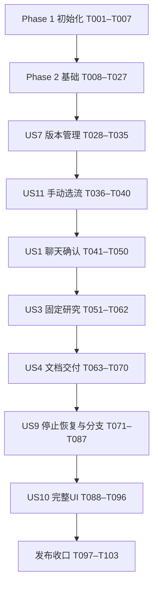

# Tasks: Personal-Agent 工作流驱动的信息研究助理（一期）

**Input**：[spec.md](spec.md)、[plan.md](plan.md)、[research.md](research.md)、[data-model.md](data-model.md)、[contracts](contracts/)、[quickstart.md](quickstart.md)。
**Created**：2026-10-19
**Scope**：用户明确只完成一期；包含 US1、US3、US4、US7、US9、US10、US11，均为 P1。US2、US5、US6、US8 及匹配、探索、沉淀、长期偏好实体/接口/页面不实施。
**Prerequisites**：阅读上述文档及 [.specify/memory/constitution.md](../../.specify/memory/constitution.md)。规划/quickstart 中“本次不生成tasks.md”描述的是先前规划阶段；本次任务生成已获用户明确请求。
**Tests**：宪章“四、自动化测试”强制要求行为变更、状态机、契约、恢复与安全验证；规格成功标准和 quickstart 已给出场景。因此纳入自动化测试任务。先编写用例并确认失败，再实现对应功能，阶段结束复跑。默认离线，真实付费调用按既定 live 条件单独进行。
**Status**：2026-10-20 当前 138 项任务中 94 项已勾选、44 项未勾选。T086/T087 的完整 Mock 阶段验收已补齐，Phase 8 任务闭合；Phase 11 的跨阶段整改及真实运行时门禁仍未闭合。勾选不替代需求质量或发布评审，验证与限制见 docs/release-evidence.md。自定义需求清单保持原有状态，不替评审者勾选。

## Format 与路径约定

- 格式为 `- [ ] TNNN [P?] [USn?] 描述及文件路径`；只有故事任务带 US 标签。
- 所有任务中的文件路径相对于仓库根 `C:/Code/spiderAgent`；业务代码统一位于 `code/`，例如 `code/backend/src/personal_agent/application/engine.py`。
- [P] 仅指同一阶段前置完成后，可与该阶段同组 [P] 项并行。它不授权跳过前置阶段，也不表示所有标记项可跨阶段同时开始。
- 未标 [P] 的任务按编号执行。实现项必须等待本阶段测试设计完成；测试编写可并行，功能验收必须等待实现。
- 每个任务采用相关设计文档中的完整字段与契约；描述逐字引用关键字段约束，不得把省略列出的普通字段删掉。新增实体时同时补迁移和持久化映射。
- 每个实现任务完成时运行最近的适用单元/契约测试；阶段末运行集成验收。若技术采用门禁失败，保留 Mock 开发路径并修订设计，真实模式不得启用。

## Phase 1: Setup — 项目初始化

**Goal**：建立可复现的 Windows 开发环境与文档基线。

**Independent Test / Checkpoint**：依赖范围可解析，三个项目入口和离线测试入口可用；候选 SDK 尚不视为已验证。

- [x] T001 核对一期范围及现有契约，补齐草稿额度追加（独立于 run 求助）、首次配置和 UI 备份恢复的请求/响应、授权及错误契约，在 specs/001-workflow-research-assistant/contracts/rest-api.md 中定义对应端点，并同步 specs/001-workflow-research-assistant/data-model.md 的关联约束；保持显式追加、不自动研究、不以用户声明替代核验，不引入二期实体。
- [x] T002 建立 Python 3.12 后端包与开发工具配置，在 code/backend/pyproject.toml 中声明 plan.md 的 FastAPI/Pydantic/SQLAlchemy/Alembic/httpx/Playwright/pytest/ruff/mypy 范围及匹配的 Harness SDK/runtime 0.2.1rc2 候选，设置 mock 默认和 live 可选依赖，创建 code/backend/src/personal_agent/__init__.py。
- [x] T003 [P] 建立 Vue 3、TypeScript 5、Vite 7、Router 4、Vitest 3 和 Playwright 项目，在 code/frontend/package.json、code/frontend/tsconfig.json、code/frontend/vite.config.ts 中配置 Node24/npm11、开发 /api 代理及 build/typecheck/test/test:e2e 入口。
- [x] T004 [P] 建立最小 TS 策略插件项目，在 code/runtime-policy/package.json、code/runtime-policy/tsconfig.json 中配置 guard/provider 挂接构建与测试入口，声明不包含业务 Loop。
- [x] T005 在 code/backend/tests/conftest.py 和 code/backend/tests/fixtures/observations.json 建立固定时钟、随机源、模型/HTTP 响应及临时工作区；默认测试阻止真实网络，live marker 必须显式启用并核对凭据和费用边界。
- [x] T006 解析依赖并生成 code/backend/uv.lock、code/frontend/package-lock.json、code/runtime-policy/package-lock.json，在 docs/dependency-baseline.md 记录 Python/Node/npm/uv、浏览器 revision 和候选 SDK 指纹；后续真实采用门禁失败保持 live 禁用，调整依赖必须重新锁定。
- [x] T007 在 .gitignore 和 .env.example 配置数据/凭据/日志排除与无秘密配置示例，在 code/scripts/check.ps1 汇总类型检查、静态检查、离线测试及策略插件测试入口；初始化 Git 仓库（main）并提交规格基线（.gitignore 与首批提交已于 2026-10-19 完成，见 origin/main `ab4229e`）。

## Phase 2: Foundational — 共享阻塞基础

**Goal**：建立显式端口、持久化、全局模型门、状态与受控产物基础；后续所有故事依赖此阶段。

**Independent Test / Checkpoint**：用固定观测验证端口、状态、事务、幂等、模型 UNKNOWN、权限和写入一致性；真实接入门禁单独记录。

- [x] T008 [P] 在 code/backend/tests/contract/test_foundation.py 编写运行时 accepted≠completed、未知输出、错误规范化、幂等键冲突、If-Match、状态事件同事务及单模型槽重启保留的失败用例。
- [x] T009 [P] 在 code/backend/tests/integration/test_managed_writes.py 编写 intent 前后、文件发布后提交前后、未知/部分/冲突与迟到结果的故障注入用例，全部使用临时目录，验证未完整保存不能成功、重复操作不重复写入。
- [x] T010 在 code/backend/src/personal_agent/domain/common.py 和 code/backend/src/personal_agent/ports/contracts.py 定义运行时、工具、仓储/UoW、渲染、时钟 DTO/协议及结构化错误；逐字落实“所有业务ID使用UUID，时间UTC RFC3339，UI以本地时区显示”“JSON列在写入和读取时按版本校验；所有可变聚合带 `revision`，更新采用CAS”，可空字段按 data-model.md 的 ? 标记，拒绝未知字段。
- [x] T011 在 code/backend/src/personal_agent/bootstrap/config.py 固定版本化政策：研究20分钟/30模型/60工具/20搜索/40页面/100000 tokens，单模型120秒/8192输出，节点3次尝试与1秒/4秒退避，HTTP10秒/30秒、浏览器30秒、收敛15秒，draft20模型/30000 tokens；保存政策hash，落实1MiB定义/64KiB事件/20MiB产物上限。
- [x] T012 在 code/backend/src/personal_agent/adapters/persistence/database.py、code/backend/src/personal_agent/adapters/persistence/uow.py 和 code/backend/alembic.ini 建立 SQLite WAL/FULL/外键/5000ms busy_timeout、独立短事务与CAS；创建 code/backend/migrations/env.py，各故事迁移按序追加，所有外键默认 RESTRICT，网络调用不持有数据库事务。
- [x] T013 在 code/backend/src/personal_agent/domain/execution.py、code/backend/src/personal_agent/adapters/persistence/execution_models.py 和 code/backend/migrations/versions/0001_execution_core.py 建立 WorkflowRun、StepRun、StepAttempt、ExecutionSlot、ExecutionEvent（后续实体引用暂存 UUID，相关实体迁移时补外键）；原文约束：“根parent为空，root=self；分支root与父一致；phase1 mode固定FIXED。版本、输入不可变；completeness=COMPLETE/PARTIAL/NO_QUALIFIED_RESULT，不能用SUCCEEDED掩盖缺口”“UNIQUE(run_id,step_id)”“UNIQUE(step_run_id,attempt_no)”“singleton_id=1”“唯一行+OS实例锁；只有收敛且无未知写入时释放；崩溃不直接把槽当空闲”“UNIQUE(owner,sequence)，provider key有值时去重；重要变更与状态同事务；无模型内部推理”；加入 data-model.md 常用索引与完整状态转换表。
- [x] T014 在 code/backend/src/personal_agent/domain/budget.py、code/backend/src/personal_agent/adapters/persistence/budget_models.py 和 code/backend/migrations/versions/0002_budget_model.py 建立 BudgetLedger、BudgetEntry、ModelRequest；逐字落实“根历史共享；预留、结算、额度追加用BudgetEntry记录；各维度非负，不以重试/分支清零”“RESERVE/SETTLE/RELEASE/GRANT；同operation同kind去重；UNKNOWN保留预留，不当零消耗”“RESERVED/IN_FLIGHT/COMPLETED/CANCELLED_CONFIRMED/UNKNOWN；全应用只有一个非终结请求；UNKNOWN不自动过期解锁”；root_run_id 或 draft_id 二选一，actual_tokens/ended_at/completion_evidence_ref 可空。
- [x] T015 在 code/backend/src/personal_agent/application/budget_service.py 实现最坏用量预留、幂等结算/释放、显式追加与有效时间计量；未知用量不按零、暂停/等待/中断不计有效时长、追加不重置重试上限，draft 和根研究分别记账并拒绝自动跨账本绕限。
- [x] T016 在 code/backend/src/personal_agent/adapters/harness/model_gateway.py 实现唯一受限模型代理及持久事务占槽，只有已配置供应商/模型路径可转发，真实密钥仅网关持有；所有澄清/生成/压缩/重试受预算和epoch检查，超时/断线/取消保留UNKNOWN与预留，仅可信完成证据解锁。
- [x] T017 在 code/backend/src/personal_agent/adapters/persistence/session_models.py 和 code/backend/migrations/versions/0003_sessions.py 建立 SessionLink，原文约束“attempt或draft二选一；provider ID允许创建未完成时为空；先存本地关联再提交任务，重复创建依operation去重”；存运行时/profile/capability指纹，补 operation_id 唯一去重记录。
- [x] T018 在 code/backend/src/personal_agent/adapters/harness/mock_runtime.py 实现同一运行时端口和可控事件/工具 Mock，覆盖 accepted、completed、failed、unknown、重复事件、迟到结果、缺失会话及兼容性错误，禁止 Mock 暗中访问真实供应商。
- [x] T019 在 code/runtime-policy/profile.json 和 code/runtime-policy/src/guard.ts 配置空工作区、官方 Loop、受限 MCP、restrict+guard；禁用 shell/fs、自动插件发现、子Agent、自修改与隐式重试，模型只能使用本地网关令牌，越权工具即使同 scope 新注册也拒绝。
- [x] T020 在 code/backend/src/personal_agent/adapters/harness/runtime.py 和 code/backend/src/personal_agent/adapters/harness/events.py 映射 capabilities/create_session/submit/events/wait_result/request_stop/reconcile/restore_session/dispose，依据实际 wheel 接口实现而非假定 cancel；白名单事件和脱敏在落盘前完成，推理仅内存，旧epoch隔离，缺失原session不冒充恢复。
- [ ] T021 在 code/backend/tests/live/test_runtime_adoption.py 和 code/runtime-policy/tests/guard.test.ts 建立并运行允许范围内的 Windows启动、固定 headless CLI 协议/退出码/版本接口、scope越权、网关无旁路、事件脱敏、无推理持久化、UNKNOWN保持/完成解锁及会话恢复契约；结果写 docs/runtime-adoption.md。按 2026-10-20 docs/harness-cli-usage.md 的载体决定，不以 Python SDK/wheel 方法冒充 CLI 能力。需要付费调用时仅在显式 live 授权及费用范围内运行；未运行或失败保持真实模式禁用，可继续 Mock 开发但不得发布。
- [x] T022 在 code/backend/src/personal_agent/domain/artifacts.py、code/backend/src/personal_agent/adapters/persistence/artifact_models.py 和 code/backend/migrations/versions/0004_artifacts.py 建立 SideEffectOperation、Blob、Artifact；原文约束“INTENT/NOT_APPLIED/APPLIED/PARTIAL/UNKNOWN/CONFLICT；同一逻辑效果跨分支查询；尝试ID不作唯一幂等依据；目标不接受任意客户端绝对路径”“不存任意绝对路径；immutable、同目录rename；访问必须经元数据权限与生命周期检查”“format=markdown；状态AVAILABLE/EXPIRED/DELETED/INTEGRITY_ERROR；内容组织report/checklist/comparison；下载失败不覆盖已生成成果”；按表中 ? 保留可空核验字段，建立 operations(root_run_id,logical_effect_key)、artifacts(run_id)、blobs(expires_at) 索引。
- [x] T023 在 code/backend/src/personal_agent/adapters/persistence/blob_store.py 和 code/backend/src/personal_agent/application/managed_writes.py 实现先intent、同目录临时文件flush/fsync、稳定目标发布、hash核验后同事务提交产物/状态/检查点/事件；结合目标历史核验APPLIED/NOT_APPLIED/PARTIAL/UNKNOWN/CONFLICT，跨root去重，孤儿清理不得删除合法引用文件。
- [x] T024 在 code/backend/src/personal_agent/api/middleware.py 和 code/backend/src/personal_agent/api/errors.py 实现工作区+路由+请求hash幂等、同键异请求409、If-Match缺失428/过期412、错误脱敏、稳定分页及版本化 DTO；幂等记录随关联业务生命周期保留，加入对应 code/backend/migrations/versions/0005_request_records.py。
- [x] T025 在 code/backend/src/personal_agent/api/security.py 和 code/backend/src/personal_agent/bootstrap/logging.py 实现本机引导会话、HttpOnly/SameSite、Host/Origin/CSRF、凭据受控注入、字段白名单日志及ACL自检，无账号/角色/租户；工具服务与管理接口隔离。
- [x] T026 在 code/backend/src/personal_agent/bootstrap/run.py、code/backend/src/personal_agent/bootstrap/lifespan.py 和 code/backend/src/personal_agent/api/health.py 建立 Proactor、OS单实例锁、单worker无reload、持久内部执行器、启动诊断和 /health、/policies；遗留运行只标中断不自动研究，真实模式检查接入证据，进程存活与 execution_available 分开。
- [x] T027 在 code/frontend/src/api/client.ts、code/frontend/src/router/index.ts、code/frontend/src/App.vue 和 code/frontend/src/components/SafeMarkdown.vue 建立客户端错误/ETag/幂等支持、单用户路由壳、禁止原始HTML及危险链接的Markdown展示；后续页面在各故事独立添加；并在 code/frontend/tests/unit/api-client.spec.ts 覆盖 ETag 取值与 412 处理、Idempotency-Key 生成、错误码到 UI 提示的映射。

## Phase 3: US7 — 修改流程、保留版本并默认查看最新（P1）

**Goal**：提供不可变工作流版本、校验、编辑与历史，作为选流基础。

**Independent Test / Checkpoint**：两个流程各修改保存3次；旧定义及运行引用不变，草稿不成为最新，冲突/失败保留修改（SC-007）。

### Tests → Models → Services → Interfaces → Integration

- [x] T028 [P] [US7] 在 code/backend/tests/contract/test_workflows.py 编写版本历史、空库、无变化保存、旧基线409、If-Match412、停用和不可用草稿的接口用例。
- [x] T029 [P] [US7] 在 code/backend/tests/unit/test_workflow_validation.py 编写环路/不可达/未声明依赖/条件分支错误/远程引用/权限放宽及表达式越界用例，期望定义不可发布。
- [x] T030 [US7] 在 code/backend/src/personal_agent/domain/workflows.py、code/backend/src/personal_agent/adapters/persistence/workflow_models.py 和 code/backend/migrations/versions/0006_workflows.py 建立 Workflow/WorkflowVersion 并补执行外键；逐字落实“1:N WorkflowVersion；latest必须属于自身且validated/confirmed，不从最大版本号盲推”“UNIQUE(workflow_id,version_no)；内容不可变；每次保存内容变化新版本；草稿可保存但不成为最新可执行；停用为另记状态事实”。
- [x] T031 [US7] 在 code/backend/src/personal_agent/domain/workflow_schema.py 和 code/backend/src/personal_agent/domain/workflow_validation.py 实现 contracts/workflow-schema.md 完整模型与语义校验：名称/描述/适用性非空且200/4000/4000字符、Schema深度20、步骤1—100、ID字母数字下划线1—64、表达式深度10/100子式；禁止远程ref、任意代码、未执行引用与权限放宽，校验所有正常路径到Output或显式失败及完成策略。
- [x] T032 [US7] 在 code/backend/src/personal_agent/application/workflow_registry.py 实现稳定JSON/hash、内容不变复用版本、草稿与确认可执行发布、CAS最新指针、基线冲突、停用事实，版本变更不得改变现有运行。
- [x] T033 [US7] 在 code/backend/src/personal_agent/api/workflows.py 实现 REST 契约全部 /workflows 列表、详情、versions读写及disable，返回hash/验证报告/草稿/实际版本；保存失败不伪造新版本。
- [x] T034 [US7] 在 code/frontend/src/pages/WorkflowVersionsPage.vue 和 code/frontend/src/components/WorkflowDefinitionEditor.vue 实现可读定义与JSON编辑、验证报告、显式可执行确认、历史与停用，冲突保留待保存内容，不引入可视化编排器。
- [x] T035 [US7] 在 code/frontend/tests/e2e/workflow-versions.spec.ts 验证双流程各三次保存、草稿隔离、旧编辑冲突与失败内容保留，运行 code/backend/tests/contract/test_workflows.py、code/backend/tests/unit/test_workflow_validation.py 并记录结果。

## Phase 4: US11 — 先从列表选择固定工作流（P1）

**Goal**：用户无需预先描述需求即可查看两个真实固定流程并选择。

**Independent Test / Checkpoint**：从列表读用途/范围/输入/步骤/输出，手动选择；空库与不适用明确反馈且无自动推荐（FR-030/031、SC-008）。

### Tests → Models → Services → Interfaces → Integration

- [x] T036 [P] [US11] 在 code/backend/tests/integration/test_seed_workflows.py 编写双流程定义合规、不同适用范围、各至少两方向及种子幂等用例。
- [x] T037 [P] [US11] 在 code/frontend/tests/unit/workflow-selection.spec.ts 编写无需输入即可浏览、空库、范围不适用和选择后传递准确版本的组件用例。
- [x] T038 [US11] 在 code/backend/workflows/technology-comparison.json、code/backend/workflows/public-topic-research.json 和 code/backend/src/personal_agent/bootstrap/seed.py 建立并幂等导入技术选型对比、公开主题研究定义，包含输入/方向/Agent或Tool/Transform/Condition/HumanReview/Output、预算与input_reads；只经Registry发布有效版本。
- [x] T039 [US11] 在 code/frontend/src/pages/WorkflowListPage.vue 和 code/frontend/src/pages/WorkflowDetailPage.vue 实现最新可执行列表、范围/输入/步骤/输出说明、分页及选择准确版本的路由；此阶段传递选中version，draft创建由US1提供，不自动研究。
- [x] T040 [US11] 在 code/frontend/tests/e2e/workflow-selection.spec.ts 用正常与独立临时空库验证选流、返回、停用及不适用说明；US1完成后复验聊天入口改选，运行本阶段测试。

## Phase 5: US1 — 表达并确认研究需求（P1）

**Goal**：以聊天补齐、明确建议和本次喜好，确认完整分层要求及准确版本。

**Independent Test / Checkpoint**：完整/缺失/纠正三类输入及SC-013六类确认情形；前五类不得启动，最终有效确认可交给启动接口；不依赖真实搜索。

### Tests → Models → Services → Interfaces → Integration

- [x] T041 [P] [US1] 在 code/backend/tests/contract/test_requirements.py 编写draft/messages/operations/suggestion accept/selection/confirm端点和草稿额度追加契约用例，覆盖旧revision/hash、错误版本、未接受建议及非显式授权。
- [x] T042 [P] [US1] 在 code/backend/tests/unit/test_requirement_confirmation.py 编写无特别偏好、具体取舍引导、来源区分、默认值、缺失/冲突/不适用、建议接受≠执行确认及H1/H2/H3摘要用例。
- [x] T043 [US1] 在 code/backend/src/personal_agent/domain/requirements.py、code/backend/src/personal_agent/adapters/persistence/requirement_models.py 和 code/backend/migrations/versions/0007_requirements.py 建立 RequirementDraft/ConversationMessage/Suggestion/Confirmation 并补相关外键；原文约束“status=COLLECTING/READY/CONFIRMED/STALE；字段含 value、source=user/default/suggestion、message_id、accepted_at；无特别偏好是显式值，非缺失”“UNIQUE(draft_id,sequence)；用户原话与模型摘要区分；仅聊天修改要求”“PENDING/ACCEPTED/REJECTED；接受不产生执行确认；旧revision建议不可直接应用”“action=START/BRANCH；每次确认不可变；绑定准确快照，不复用过期确认”；绑定表中全部hash、政策与版本字段，建立 runs.confirmation_id 唯一约束。
- [x] T044 [US1] 在 code/backend/src/personal_agent/application/requirement_analysis.py 通过统一Runtime/ModelGateway分析聊天，基于本次方向追问和引导具体取舍，禁止固定偏好问卷/擅自权重/长期偏好；必要字段与硬约束由确定性校验，模型建议保持待接受并记录依据。
- [x] T045 [US1] 在 code/backend/src/personal_agent/application/requirement_confirmation.py 和 code/backend/src/personal_agent/adapters/rendering/requirement_summary.py 实现完整摘要三级标题与列表、revision/hash、过期确认失效、格式协商、改选重检与显式确认；接受建议后仍需确认完整列表，不为凑标题编造要求。
- [x] T046 [US1] 在 code/backend/src/personal_agent/application/draft_operations.py 实现可持久查看的分析操作、忙时待分析、草稿独立额度求助与显式追加，不把待分析聊天自动转为研究启动，不以“知道了”授权，恢复后保持模型UNKNOWN阻塞。
- [x] T047 [US1] 在 code/backend/src/personal_agent/api/requirements.py 和 code/backend/src/personal_agent/api/operations.py 实现全部需求与操作查询契约及T001定义的草稿追加接口，BRANCH确认仅限关联proposal，缺失/冲突/版本变化返回具体错误。
- [x] T048 [US1] 在 code/frontend/src/pages/RequirementsPage.vue 和 code/frontend/src/components/RequirementSummary.vue 实现聊天、来源/建议、缺失冲突、完整摘要、版本与政策展示、建议接受及最终确认；输入修改仅走聊天，明确无特别偏好和取舍顺序。
- [x] T049 [US1] 在 code/frontend/src/components/DraftBudgetPanel.vue 实现草稿消耗、待分析/模型忙/UNKNOWN原因与额度追加反馈，确认旧摘要或改选后隐藏失效启动动作；与RequirementsPage集成；并在 code/frontend/tests/unit/draft-budget.spec.ts 覆盖草稿消耗、待分析/模型忙/UNKNOWN 原因展示及追加额度后的刷新与失效启动隐藏。
- [x] T050 [US1] 在 code/frontend/tests/e2e/requirements.spec.ts 验证SC-001输入三例、SC-006四类喜好和SC-013六类确认；用受控启动接收端确认授权边界，US3完成后复验真实 /runs，运行本阶段后端用例。

## Phase 6: US3 — 严格按流程研究信息（P1）

**Goal**：按确认版本和规则串行研究并保留方向、来源、证据及可信状态。

**Independent Test / Checkpoint**：固定观测下至少8例覆盖正常/条件/失败/版本变化/注入；无越权跳步，来源缺失如实标记（SC-003/005）。

### Tests → Models → Services → Interfaces → Integration

- [x] T051 [P] [US3] 在 code/backend/tests/unit/test_engine.py 编写六节点调度、表达式边界、必需路径、错误输出、有界重试、规则不受模型文本影响及控制决策重放用例。
- [x] T052 [P] [US3] 在 code/backend/tests/contract/test_tools.py 编写搜索/HTTP/浏览器/提取契约，覆盖scope/epoch/预算、私网与重定向、DNS rebinding、子资源、恶意页面和停止收敛。
- [x] T053 [US3] 在 code/backend/src/personal_agent/domain/research.py、code/backend/src/personal_agent/adapters/persistence/research_models.py 和 code/backend/migrations/versions/0008_research.py 建立 ResearchAction、Source、Evidence；原文约束“每个定义方向都有动作结果或缺口；参数先脱敏，外部内容标untrusted”“获取时间必填；无法确认的发布时间为空，不从获取时间推断；内容hash用于去重，不抹去不同获取时间”“classification=FACT/OPINION/INFERENCE；validity=VERIFIED/UNVERIFIED/OUTDATED/CONFLICTED；重要外部事实须来源或未证实标记”；Source的published_at/updated_at/blob_id/deleted_at可空。
- [x] T054 [US3] 在 code/backend/src/personal_agent/adapters/tools/scope.py 和 code/backend/src/personal_agent/adapters/tools/mcp_service.py 实现握手令牌、节点scope、epoch、参数Schema、停止标志和预算校验；仅受管stdio/loopback，禁止管理操作和任意脚本，域名空列表拒绝网络，URL/DNS/重定向/子资源均验证且TLS开启。
- [x] T055 [US3] 在 code/backend/src/personal_agent/adapters/tools/search.py 和 code/backend/src/personal_agent/adapters/tools/http_fetch.py 实现Brave与共享httpx适配，读取受控凭据、不自动回退抓搜索引擎，超时或受限来源返回SOURCE_UNAVAILABLE并保留来源时间/缺口。
- [x] T056 [US3] 在 code/backend/src/personal_agent/adapters/tools/browser_read.py 和 code/backend/src/personal_agent/adapters/tools/extract.py 实现按run隔离的Playwright context与纯解析提取；采用原生timeout/协作停止，不以Task.cancel伪称结束，不复用用户浏览器cookies、不绕登录/验证码，需要模型提取时显式经网关。
- [x] T057 [US3] 在 code/backend/src/personal_agent/application/research_evidence.py 实现每方向结果/缺口、来源去重与不同获取时间、冲突/过期/未证实标记、硬约束SATISFIED/VIOLATED/UNKNOWN及最终确认偏好排序，缺依据信息不进入合格推荐。
- [x] T058 [US3] 在 code/backend/src/personal_agent/application/coordinator.py 实现START确认校验、确认唯一消费、单执行槽CAS、模型未知/未收敛写入阻塞与显式启动，不自动排队切换；冻结输入/版本/配置/运行时指纹。
- [x] T059 [US3] 在 code/backend/src/personal_agent/application/engine.py 和 code/backend/src/personal_agent/domain/expressions.py 实现DAG串行调度、绑定与依赖检查、六节点派发、结构/语义验证、显式exhausted路径、SKIPPED依据、预留/结算与epoch检查；HumanReview先进入WAITING_USER，Output使用受管写入端口，专门交付实现由US4接入。
- [x] T060 [US3] 在 code/backend/src/personal_agent/api/runs.py 实现 POST/GET /runs、详情与steps快照，返回实际版本/步骤/消耗/完整程度/allowed_actions；端点不自行推进状态，只有引擎可提交StepRun。
- [x] T061 [US3] 在 code/frontend/src/pages/RunProgressPage.vue 实现真实快照的步骤、方向/来源摘要、等待原因、实际版本与资源消耗，未完成恢复操作暂不开放，US9接入后替换为服务端允许动作。
- [x] T062 [US3] 在 code/backend/tests/integration/test_fixed_research.py 验证至少8个固定观测案例及两流程的研究路径，运行本阶段单元/契约测试；Output以契约夹具独立验收调度，US4完成后复验实际文档交付。

## Phase 7: US4 — 按本次要求获得文档（P1）

**Goal**：将证据转为符合本次约定的可获取Markdown文档，完整程度真实可见。

**Independent Test / Checkpoint**：固定材料产生报告/清单/对比表和两组偏好差异；来源/缺口/未知条件清楚，下载失败后仍可重新获取（SC-005/006/008）。

### Tests → Models → Services → Interfaces → Integration

- [x] T063 [P] [US4] 在 code/backend/tests/contract/test_artifact_delivery.py 编写产物元数据/内容/410、hash/安全文件名、重复获取不重新研究和部分文档不伪报完整成功的契约用例。
- [x] T064 [P] [US4] 在 code/backend/tests/unit/test_document_rendering.py 编写三种内容结构、两组偏好、必需栏目、无合格结果、冲突/过期/未证实来源与危险链接用例。
- [x] T065 [US4] 在 code/backend/src/personal_agent/domain/document_content.py 定义目标、约束、方向结果、理由、来源、缺口及完整程度的文档契约；重要外部事实须来源或未证实标记，只有全部硬约束SATISFIED的候选可作合格推荐，排序仅用已确认priority。
- [x] T066 [US4] 在 code/backend/src/personal_agent/adapters/rendering/markdown.py 实现report/checklist/comparison渲染及约定语言/详略；如需模型组织内容只走统一运行时并再次校验，禁原始HTML/危险链接，不支持格式需执行前协商。
- [x] T067 [US4] 在 code/backend/src/personal_agent/application/artifact_service.py 接入Output与受管写入，hash验证后提交Artifact及完成程度；按completion_policy决定run状态，允许的部分交付可为SUCCEEDED但completeness必须为PARTIAL，不满足策略则保留部分文档且run为FAILED/WAITING_USER，下载重试仅追加访问事实。
- [x] T068 [US4] 在 code/backend/src/personal_agent/api/artifacts.py 实现 /runs/{id}/artifacts、/artifacts/{id}、/content，读取时检查生命周期与完整性，受控路径和脱敏错误，删除/过期410。
- [x] T069 [US4] 在 code/frontend/src/pages/ArtifactPage.vue 和 code/frontend/src/components/SourceList.vue 实现阅读/保存/再次获取、版本/来源/理由/缺口及完整程度展示，不把获取失败显示已交付。
- [x] T070 [US4] 在 code/frontend/tests/e2e/artifacts.spec.ts 验证三结构、两偏好、无合格与部分成果、获取失败重试；用 code/backend/tests/integration/test_document_checkpoint.py 验证真实Output与状态一致，并运行本阶段测试。

## Phase 8: US9 — 状态、停止、恢复、执行分支与额度求助（P1）

**Goal**：以可信状态和完整历史支持暂停/取消、原ID继续、新分支重跑及人工处置。

**Independent Test / Checkpoint**：SC-012中断与写入矩阵、SC-014六类历史、SC-015四类输入影响、SC-016七类停止/额度、SC-017六类串行情形全部可独立用固定记录验证。

### Tests → Models → Services → Interfaces → Integration

- [x] T071 [P] [US9] 在 code/backend/tests/contract/test_run_controls.py 编写pause/cancel/resume/assistance/side-effects/branch-proposals/history接口用例，包括错误状态、过期revision、重复授权及分支确认唯一性。
- [x] T072 [P] [US9] 在 code/backend/tests/integration/test_recovery.py 编写节点完成/未完成、文件已生效未记账/未生效/部分/未知/后来改动、资料过期删除、版本不兼容、cancel_requested和迟到结果的恢复用例。
- [x] T073 [P] [US9] 在 code/backend/tests/integration/test_serial_execution.py 编写双击/跨任务/分支切换/运行中聊天/超时重试/停止仍在途六例及重启UNKNOWN，用下游请求计数证明执行分支≤1、实际模型请求≤1。
- [x] T074 [US9] 在 code/backend/src/personal_agent/domain/assistance.py、code/backend/src/personal_agent/adapters/persistence/assistance_models.py 和 code/backend/migrations/versions/0009_assistance.py 建立 AssistanceRequest、UserDecision；原文约束“kind=BUDGET_LIMIT/WRITE_RECONCILIATION/HUMAN_REVIEW/RUNTIME_UNCERTAIN；OPEN/RESOLVED/CANCELLED；必须提供实质求助信息”“聊天讨论可记录但不解除阻塞；追加额度和继续为不同显式字段；不可只凭用户声称成功跳过写入核验”；保存全部limit/consumed/步骤/问题/未知/已尝试字段，kind与status分开枚举。
- [x] T075 [US9] 在 code/backend/src/personal_agent/domain/branches.py、code/backend/src/personal_agent/adapters/persistence/branch_models.py 和 code/backend/migrations/versions/0011_branches.py 建立 BranchProposal/ReusedResult；原文约束“DRAFT/BLOCKED/READY/CONFIRMED；确认新输入及最终起点后才创建run；影响不明标BLOCKED，不自动前移”“UNIQUE(run_id,step_id,artifact_id)；只允许起点前有效依赖成果；不是新执行的成功attempt；来源可追溯至父链”“proposal对应创建的run唯一”；原输入/hash与历史只追加。
- [x] T076 [US9] 在 code/backend/src/personal_agent/application/stop_control.py 实现停止新增行动、PAUSING/CANCELLING、draining及15秒反馈，动作收敛才终结；未知保持INTERRUPTED/cancel_requested，核验后只能完成取消，禁止迟到结果把CANCELLED改成成功。
- [x] T077 [US9] 在 code/backend/src/personal_agent/application/recovery.py 实现启动只诊断与显式resume，核验输入/定义/状态schema/runtime/profile/产物hash及时效，核验整条root写入与模型结果；原run追加新attempt/epoch/session，已成功节点不重做，不兼容或UNKNOWN不得自动解锁。
- [x] T078 [US9] 在 code/backend/src/personal_agent/application/assistance_service.py 实现完整求助、决策记录与HumanReview结果校验；GRANT_AND_CONTINUE必须同时显式额度追加/继续且阻塞已解，DISCUSS和沉默保持等待，CHANGE_REQUIREMENTS走分支，CANCEL走取消，RECONCILE不能信任客户端APPLIED声明。
- [x] T079 [US9] 在 code/backend/src/personal_agent/application/branch_analysis.py 实现起点存在/可达/前置核验、changed_paths+input_reads传递闭包、时效/完整性检查；影响不明或依赖缺失标BLOCKED并建议更早起点，不自动改变选择，展示失效成果和要求差异。
- [x] T080 [US9] 在 code/backend/src/personal_agent/application/branch_service.py 实现派生draft、BRANCH确认与最终起点/report_hash绑定、parent/root和源成果引用；新run仅复用起点前有效成果、共享根预算且核验全root副作用，同proposal/confirmation不能生成多个run。
- [x] T081 [US9] 在 code/backend/src/personal_agent/api/run_controls.py、code/backend/src/personal_agent/api/branches.py 和 code/backend/src/personal_agent/api/assistance.py 实现全部停止/恢复/分支/求助/副作用核验契约；统一返回 allowed_actions、disabled_reason、draining、在途事实及可信历史，恢复不能绕过额度求助。
- [x] T082 [US9] 在 code/backend/src/personal_agent/api/events.py 实现提交后SSE与event-history：快照游标、Last-Event-ID、15秒心跳、默认100最大1000分页、最多1000缓冲、stream.reset、删除410；重复仅重放、不重复动作或结算，慢消费者不占长事务。
- [x] T083 [US9] 在 code/frontend/src/api/events.ts 和 code/frontend/src/stores/run.ts 实现快照后订阅、(run_id,sequence)去重、断线补读/reset重取、迟到与draining展示；停止按钮和恢复按钮以服务端allowed_actions为准。
- [x] T084 [US9] 在 code/frontend/src/components/RunControls.vue 和 code/frontend/src/components/AssistancePanel.vue 实现分别暂停/取消、继续前核验、额度/问题/未知/已尝试/可选处置展示及显式授权；仅讨论和未回应不自动继续。
- [x] T085 [US9] 在 code/frontend/src/pages/ExecutionHistoryPage.vue 和 code/frontend/src/components/BranchProposalPanel.vue 实现节点/父根/分叉/源成果、选点重跑、聊天修改差异、受影响起点和双确认，不要求用户操作Git。
- [x] T086 [US9] 在 code/frontend/tests/e2e/recovery-branches.spec.ts 覆盖两次续跑同ID、首节点/较早/再次分叉、前置不足、写入核验及四类输入影响；在 code/backend/tests/contract/test_events.py 覆盖提交顺序、重放/去重、游标清理和慢消费者；并在 code/frontend/tests/unit/event-store.spec.ts 覆盖 (run_id,sequence) 去重、断线补读、stream.reset 重取与迟到事件展示。
- [x] T087 [US9] 在 code/frontend/tests/e2e/stop-budget-serial.spec.ts 覆盖SC-016七例和SC-017六例，运行本阶段全部用例与 foundational 写入用例，在 docs/recovery-verification.md 记录控制决策hash/版本/事件/attempt证据及未运行项。

## Phase 9: US10 — 通过完整 UI 独立完成任务（P1）

**Goal**：整合单用户真实产品链路、初始配置、数据生命周期与维护入口。

**Independent Test / Checkpoint**：初始配置后无需命令独立完成三次研究并保存文档、一次停止和失败后再发起；所有异常有原因和后续动作（SC-001/008/009、A1—A5）。

### Tests → Models → Services → Interfaces → Integration

- [ ] T088 [P] [US10] 在 code/frontend/tests/e2e/complete-journey.spec.ts 编写完整/缺失/纠正三类选流至文档案例，版本修改、停止和失败后再发起，以及空库/不适用/来源失败/模型未知/写入冲突/删除等异常界面用例。
- [x] T089 [P] [US10] 在 code/backend/tests/integration/test_data_lifecycle.py 编写主动删除/到期、共享引用、缓存/session/日志/备份清理、墓碑、旧备份恢复不复活和不安全恢复阻断用例。
- [x] T090 [US10] 在 code/backend/src/personal_agent/adapters/persistence/lifecycle_models.py 和 code/backend/migrations/versions/0011_lifecycle.py 建立 DeletionRecord/BackupManifest；原文约束“backup含db revision、blob hash清单、expires_at”“删除后普通查询不得读取内容；恢复先应用删除记录；共享blob在仍有合法引用时不能误删，但被删除资料不能经别的引用绕过”；记录affected_ids/requested_at/completed_at/backup_ids并与相关实体建立RESTRICT关系。
- [x] T091 [US10] 在 code/backend/src/personal_agent/application/data_lifecycle.py 和 code/backend/src/personal_agent/api/data_items.py 实现data-items/deletions、立即访问及复用阻断、异步物理清理与操作查询；执行缓存日志7天/会话最多7天且尽快销毁/业务90天/备份7天政策，显式墓碑不保存敏感内容，失效跨分支引用。
- [x] T092 [US10] 在 code/backend/src/personal_agent/bootstrap/backup.py 和 code/backend/src/personal_agent/bootstrap/restore.py 实现维护模式收敛、SQLite backup API及blob/hash/schema/删除清单、临时恢复验证、失败迁移恢复、版本不兼容拒绝与恢复后中断不自动续跑；不直接复制活跃主DB或破坏性downgrade。
- [x] T093 [US10] 在 code/backend/src/personal_agent/api/settings.py 和 code/backend/src/personal_agent/api/maintenance.py 实现T001补齐的本机配置与维护接口；只返回配置健康状态不回显秘密，备份与恢复需显式操作且不得绕过未知在途，恢复前后均应用生命周期政策。
- [x] T094 [US10] 在 code/frontend/src/pages/SetupPage.vue、code/frontend/src/pages/DataManagementPage.vue 和 code/frontend/src/pages/MaintenancePage.vue 实现配置健康、受控凭据配置、存储/授权/费用上限/保留政策、删除影响确认、备份恢复状态及原因；不要求注册或切换角色。
- [x] T095 [US10] 在 code/frontend/src/router/index.ts、code/frontend/src/App.vue 和 code/backend/src/personal_agent/bootstrap/lifespan.py 贯通所有故事页面与生产同源静态资源，首页直接选流，真实模式仅启用已验证runtime；完整闭环不得依赖内部数据修改或二期入口。
- [ ] T096 [US10] 在 code/frontend/tests/e2e/maintenance.spec.ts 验证配置/删除/备份/恢复界面，在 code/backend/tests/integration/test_backup_restore.py 验证成功升级、迁移失败恢复与不兼容拒绝；运行本阶段完整链路及生命周期用例，记录 docs/ui-acceptance.md。

## Phase 10: Polish & Cross-Cutting — 一期发布收口

**Goal**：完成全部一期标准、安全、性能、真实接入与可复现交付；不增加二期功能。

**Independent Test / Checkpoint**：所有一期SC和A1—A5有证据；默认测试离线通过，live证据独立且不足时不得标发布完成。

- [ ] T097 [P] 在 code/backend/tests/integration/test_security_boundaries.py 覆盖网页提示注入、恶意URL/重定向/私网/子资源、路径穿越、scope越权、CSRF/Host/Origin、日志/SSE/导出/备份脱敏；修正相关模块后复跑，仅在临时工作区注入。
- [ ] T098 [P] 在 code/backend/tests/integration/test_phase1_stability.py 完成两流程×三组输入×两次共12次离线完整研究，核对文档、来源/缺口、版本和控制决策重放；用 docs/acceptance-matrix.md 汇总SC-001/003/005—009/012—017与A1—A5证据。
- [ ] T099 [P] 在 code/backend/tests/integration/test_performance.py 和 code/frontend/tests/e2e/progress-latency.spec.ts 建立10000执行记录基线，测列表/详情不含模型p95<500ms、提交事件到UI p95<1s、停止接收反馈<1s，在 docs/performance.md 记录环境、口径、结果和优化后的复验。
- [ ] T100 在 code/backend/tests/live/test_phase1_delivery.py 通过真实UI/服务链路分别运行两个流程，检查官方Loop、所有模型请求纳管、真实来源和可获取文档；仅在用户明确启用live、配置凭据并确认费用范围后执行，结果写 docs/live-acceptance.md，未运行/失败不以Mock替代。
- [x] T101 在 code/scripts/start.ps1 和 code/scripts/package.ps1 提供安装检查、固定依赖与浏览器版本、自检、单实例生产启动和构建产物；更新 specs/001-workflow-research-assistant/quickstart.md 中目标命令为实际可用入口及状态，使用干净临时工作区验证。
- [ ] T102 运行 code/scripts/check.ps1 的全部适用检查和相关UI/策略测试，修正失败并在 docs/release-evidence.md 记录命令、结果、锁文件指纹、宪章符合性、迁移/恢复证据及未运行限制；缺陷先补失败用例，任何强制门禁未满足不得标一期完成。
- [ ] T103 在 specs/001-workflow-research-assistant/plan.md 和 docs/release-evidence.md 更新实施结果、已验证依赖与残余限制，复核所有一期故事/契约覆盖和二期排除；尊重 checklists/workflow.md 的评审者勾选权，不以实现完成自动勾选需求清单。

## Dependencies & Execution Order

### 阶段与故事依赖图

所有故事同为一期 P1，以上采用业务依赖排序，保留原故事编号，不按编号错误地让 US1 先于选流基础。独立测试指用固定契约夹具隔离上游，不表示生产功能无依赖。

| 阶段/故事 | 必需前置与衔接 |
|---|---|
| 基础 | T001–T007 完成后开始。T008/T009 可并行编写；T010–T027 依次实现。T021 的真实接入证据不足时只能通过已测 Mock 继续开发，真实模式和最终发布保持阻塞。 |
| US7 | 基础完成；校验先于发布，Registry 先于接口与编辑页面。 |
| US11 | US7 提供有效版本及列表接口；本阶段不创建RequirementDraft以避免重复建模。选中version传给US1，T050完成选流到聊天集成复验。 |
| US1 | US7+US11+统一模型门；确认仅生成授权快照。T050可用受控启动接收端独立验收，T062/T088/T096在实际启动链路再次核验。 |
| US3 | US1确认、US7固定版本、基础槽位/预算/受管写入；先工具授权再工具接入，再编排与启动。T059的HumanReview先保存WAITING_USER，US9实现其用户处置闭环。 |
| US4 | US1输出约定、US3证据、基础受管写入；T067将真实文档服务接到US3 Output并复验完成策略。 |
| US9 | US1派生draft、US3执行与US4产物；先状态模型，再停止/恢复/求助，再分支影响分析与创建；最后接SSE和UI，不提前开放尚未实现的控制操作。 |
| US10 | 全部上述故事完成，提供完整实际链路；删除与恢复贯通分支引用，T001契约先于配置/维护接口。 |
| 发布 | 所有一期故事验收通过；安全、稳定、性能可分别准备证据，真实模式必须有T021和T100结果；缺任何强制结果均不得宣告一期发布完成。 |

### 明确的跨任务依赖

- T013执行核心暂存其他聚合的UUID引用；T030、T043等对应迁移建立实体时补齐外键和唯一约束，T102检查最终不存在未落实的业务引用约束。
- T020运行时和T021接入验证依赖T016模型网关、T017会话记录、T018 Mock端口与T019策略插件；接入烟测使用受控测试工具，正式业务工具由T054–T056接入后在T100复验。
- T023受管写入只有核验完成才提交成功；US4的T067与US9的T077均必须复用该协议，不能各自实现不一致的副作用判定。
- T046草稿预算使用独立账本；T078运行求助使用根研究账本，T001需明确两种授权契约，不把未创建run的草稿强行挂到run求助接口。
- T001为阶段硬门禁：未完成则 Phase 2 及后续阶段不得开工；同时是 T041、T047、T071、T081、T093 的前置，四组契约（草稿额度追加、首次配置、备份恢复、维护）未写入 rest-api.md 前，对应接口与契约测试任务不得开始。
- T080分支创建依赖T079影响报告、T045完整要求确认、T078额度授权与T077恢复核验；新ID不得绕过任何前置。
- T082只发布已提交事件，T083消费游标和快照；事件通知失败通过重放补齐，不能重新触发业务动作。
- T092备份恢复、T093维护端点与T094维护UI依次完成，T096再做真实临时目录恢复演练。

## Parallel Examples — 每个故事的可并行示例

以下均为完成该阶段前置后的测试编写分工；不是同时运行多个业务执行或模型请求。默认离线测试仍使用固定依赖。

| 故事 | 可同时编写的任务 | 合流点 |
|---|---|---|
| US7 | T028版本接口契约；T029定义校验单元用例 | T030模型与迁移 |
| US11 | T036种子与幂等集成用例；T037选流组件用例 | T038种子定义 |
| US1 | T041需求接口契约；T042确认规则单元用例 | T043需求实体 |
| US3 | T051调度单元用例；T052工具契约用例 | T053研究实体 |
| US4 | T063产物接口契约；T064文档结构单元用例 | T065文档内容模型 |
| US9 | T071控制接口；T072恢复故障注入；T073全局串行用例 | T074求助实体 |
| US10 | T088完整链路UI用例；T089生命周期用例 | T090生命周期实体 |

初始化T003/T004可以并行建立不同项目文件；基础T008/T009可以并行编写契约与故障注入；收口T097/T098/T099可以在不同测试与证据文件开展。涉及共同迁移、公共路由、模型网关和核心状态机的修改按任务顺序合并，不能因标记并行而改同一文件。

## Requirement / Contract Coverage

| 范围 | 实施与验收任务 |
|---|---|
| FR-001/002/004；SC-001/013 | T041–T050、T058–T062、T088、T096 |
| FR-006/007/008/009；SC-003 | T051–T062、T097（注入验证）、T098 |
| FR-010/011/012；SC-005/006 | T041–T050、T057、T063–T070 |
| FR-020/021/022；SC-007 | T028–T035 |
| FR-024/025/032/033；SC-012/014/015/016/017 | T008–T026、T058–T062、T071–T087、T098 |
| FR-026；A1–A3 | T018–T021、T025、T054–T056、T063–T070、T097、T100 |
| FR-027；A4 | T022–T023、T089–T096 |
| FR-028/029；SC-008/009、A5 | 各故事页面、T025–T027、T088–T096 |
| FR-030/031 | T036–T050 |
| Workflow Definition契约 | T028–T035、T038、T051–T062 |
| Runtime/Tool/Model Gateway契约 | T008、T010、T014–T021、T052–T056、T073、T076–T077、T100 |
| REST通用/工作流/需求/运行/分支/求助/产物/SSE/删除契约 | T024–T027、T028、T033、T041、T047、T060、T063、T068、T071、T081–T083、T089、T091 |
| 数据实体与约束 | T010–T015、T017、T022、T030、T043、T053、T074–T075、T090及对应迁移 |
| 迁移、备份与恢复 | T012及各故事迁移、T092–T096、T102 |
| 工程基线与发布证据 | T006、T007、T101–T103 |
| 二期FR-003/005/013–019/023及SC-002/004/010/011 | 明确排除，不创建待办或一期发布依赖 |

## Implementation Strategy — 分步交付

1. **首个可评审增量**：完成基础 + US7 + US11 + US1（T001–T050），可手动选流、聊天澄清和确认要求。它是需求确认增量，尚不是研究助理的完整MVP。
2. **研究闭环增量**：加入US3与US4（至T070），在固定依赖下跑通研究和可保存文档；HumanReview处置及完整停止/恢复仍待US9，因此此时不作为一期发布。
3. **建议的一期MVP**：完成全部七个一期故事（至T096），包括停止、原ID续跑、分支、额度求助、串行约束和完整UI；这些是已确认的一期必需能力，不因“MVP”删减。
4. **交付门禁**：完成T097–T103并留存真实接入和真实文档证据。Mock用于独立开发与回归，不能替代真实能力发布验证。
5. **后续阶段**：二期另行规划任务，不预建其实体与页面；不因扩展接口占位引入额外平台。

## Notes

- 新增任务全部未勾选。实现任务的完成标记与需求质量清单的评审标记是不同含义。
- 模型与工具的非确定性观测需保留hash/版本/事件/attempt以复核控制决策；不保存逐字内部推理。
- 架构只允许引擎推进状态；官方Harness承担节点内Loop，不能在Python适配器或TS策略插件重写Loop。
- 实现遇到契约冲突先记录并修正文档，不私自扩展一期范围；当前38项自定义质量清单尚未由评审者逐项裁定，不能声称全部需求已审查通过。
- 此次任务生成不执行live调用、安装、迁移或发布；后续执行遵守对应任务的条件。

## Phase 11: Convergence

**Assessment date**：2026-10-20（Asia/Shanghai）。评估时仅追加本节，保留 T001–T103 的原文、顺序与勾选；评估时本节任务均未实施。后续实施进度见下方记录。
**Scope / evidence**：核对一期 23 项 FR、13 项 SC、47 个故事验收场景、A1–A5、103 项现有任务、7 项核心执行决策、9 个一期架构模块及技术约束、5 项宪章原则。F1–F35 与下列 T104–T138 一一对应：CRITICAL 18 / HIGH 13 / MEDIUM 3 / LOW 1；missing 3 / partial 14 / contradicts 17 / unrequested 1。
**Verification / order**：本次为源码与现有测试的收敛评估，另以 uv/CPython 3.12.9 离线内存核验复现了无修改分支被阻止、必填 user=null 被判完整、相反偏好排序相同三例；未运行全量静态/类型/自动化/UI/live 测试。代码修复先补可复现的失败测试，再实现并运行适用检查。优先处理宪章违规项；这些补缺任务不替代原有未完成任务或发布门禁。T021/T100 及本节对应真实验证任务仍须用户显式授权与费用范围，当前请求不授权真实供应商调用；未满足时记录阻断而非伪造通过，不引入二期功能。

- [x] T104 CRITICAL（F1）将 code/backend/src/personal_agent/application/engine.py 的 AgentTask、澄清及官方 Loop 内生成/压缩/重试全部接入 code/backend/src/personal_agent/adapters/harness/model_gateway.py；占槽采用持久原子条件更新或唯一约束，校验模型白名单、owner、epoch、预留与可信完成证据，超时/本地取消跨重启保留 UNKNOWN；修正 code/backend/tests/integration/test_serial_execution.py 仅计 submit、空 ModelRequest 时间区间也能通过的断言，以真实下游请求证明并发上限为 1 per Constitution I、技术约束；FR-033；T014/T016/T073 (contradicts)
- [x] T105 CRITICAL（F2）修正 code/backend/src/personal_agent/application/engine.py、code/backend/src/personal_agent/application/budget_service.py 与 code/backend/src/personal_agent/adapters/tools/mcp_service.py：每次实际模型/工具调用使用独立且可幂等重放的 operation_id，结算完整 model/tool/search/page/token 用量，官方 Loop 内动作逐次预留；未知用量保留预留，失败已发生用量不漏记；落实节点 policy.max_attempts 与全局上限的较小值，恢复、分支或追加额度不得重新获得已耗尽的尝试次数 per Constitution I；FR-024/033；T015/T054/T059 (contradicts)
- [x] T106 CRITICAL（F3）在 code/backend/src/personal_agent/application/engine.py、code/backend/src/personal_agent/application/budget_service.py 和 code/backend/src/personal_agent/application/assistance_service.py 接入可控单调时钟，累计有效研究时长并排除暂停/等待/中断；执行定义的更严格预算及节点/模型/工具 deadline（当前传 now 且无等待超时），触及任何上限事务性进入 WAITING_USER/BUDGET_LIMIT 并保存完整求助，不进入普通 FAILED 或自动 exhausted 绕行；只有明确追加与继续且核验通过才原 ID 恢复，增加时间、资源、仅讨论与未回应回归 per Constitution I、技术约束；FR-024；US9/AC9–10；T011/T015/T076/T078 (contradicts)
- [ ] T107 CRITICAL（F4）补齐 code/backend/src/personal_agent/domain/requirements.py、code/backend/src/personal_agent/application/requirement_analysis.py、code/backend/src/personal_agent/application/requirement_confirmation.py 与 code/backend/src/personal_agent/application/engine.py 的结构及语义校验：必要字段 null/空值/类型错误、嵌套 required、未知字段、硬约束冲突和适用范围均阻止依赖执行；实际解析 Step.bindings、ToolTask.arguments_bindings、context/content bindings 并验证 depends_on、输入及所有节点输出 schema，不把 Binding 对象直接传工具；先补当前 user=null 被判完整、非法输入与缺依赖仍执行的失败用例 per Constitution I、技术约束；FR-002/006/007；T044/T058/T059 (contradicts)
- [ ] T108 CRITICAL（F5）在 code/backend/src/personal_agent/application/requirement_confirmation.py、code/backend/src/personal_agent/application/coordinator.py、code/backend/src/personal_agent/application/branch_service.py 与 code/backend/src/personal_agent/adapters/rendering/requirement_summary.py 将全部字段、已接受建议、偏好顺序、output_spec、政策及预算纳入展示与摘要 hash；原子校验确认对应的 draft revision/内容/版本/政策且唯一消费；选流后出现新版本时提示并重新确认，不静默沿用旧确认；分支 confirmation 必须与固定版本和最终报告一致，拒绝被后续聊天、改选或政策变更作废的确认 per Constitution I；FR-004/006/031/032；US11/AC5；T043/T045/T058/T080 (contradicts)
- [x] T109 CRITICAL（F6）补齐 code/backend/src/personal_agent/application/engine.py、code/backend/src/personal_agent/application/recovery.py 与 code/backend/src/personal_agent/adapters/persistence/session_models.py 的真实 attempt 输入/hash、先落本地会话关联再提交及运行时事件消费；结果/转换/步骤完成/检查点/事件保持同事务，Output 不在文件保存前标 attempt 成功；恢复按 schema/定义/输入/配置/会话及全部复用成果 hash/时效核验并重建来源和证据（当前 run() 清空后只恢复 output 字典），保留失败 exhausted 路径且不覆盖旧 attempt；覆盖研究完成后及文件发布前后崩溃 per Constitution II；FR-025；SC-012；T017/T020/T023/T077 (contradicts)
- [ ] T110 CRITICAL（F7）修正 code/backend/src/personal_agent/application/stop_control.py、code/backend/src/personal_agent/application/recovery.py、code/backend/src/personal_agent/application/engine.py、code/backend/src/personal_agent/application/artifact_service.py 和 code/backend/src/personal_agent/application/coordinator.py：将真实在途模型、工具及整条 root 的未知/部分写入纳入收敛，15 秒后如实标中断并保留槽；停止信号贯穿 runtime/tools，所有迟到结果及 Output 提交以当前 epoch/终态校验，不把等待/未知 attempt 记成功；恢复用 CAS 获取执行槽、检查未结求助和预算，双恢复/恢复与新启动不得并发；任意启动不能绕过遗留未核验写入 per Constitution II、技术约束；FR-024/025/033；T026/T058/T076–T081 (contradicts)
- [ ] T111 CRITICAL（F8）修正 code/backend/src/personal_agent/application/branch_service.py、code/backend/src/personal_agent/application/branch_analysis.py 与 code/backend/src/personal_agent/application/engine.py：新分支实际从 fork_step_id 开始，只加载显式列出的起点前有效成果及其父链来源，不扫描继承全部成功 output 或重做前缀；阻止当前/未来/从未执行节点作为更早分叉起点；对成果校验 hash、expiry、删除、适用性及传递依赖，changed_paths 包含 preference_order/output_spec；影响不明阻塞且由用户选择可验证更早起点；保存创建原因并覆盖分支再次分叉及失效依赖 per Constitution II；FR-032；US9/AC6–8；T075/T079/T080 (contradicts)
- [ ] T112 CRITICAL（F9）在 code/backend/src/personal_agent/adapters/persistence/base.py 及各持久映射/服务为外部和持久 JSON 建立版本化读写校验，拒绝未知 schema/非法枚举与 owner 组合；补全 root/parent、slot、ledger owner、session、event 等已声明业务引用的 RESTRICT 外键及根父一致性，所有可变聚合更新使用真实 CAS 而非读 revision 后赋值；在 code/backend/migrations/versions/ 追加兼容迁移与回退说明，以损坏 JSON、孤立引用、双写及旧版本恢复测试验证，不手改旧迁移 per Constitution 技术约束；T010/T012/T013/T014/T043/T102 (contradicts)
- [ ] T113 CRITICAL（F10）修正 code/backend/src/personal_agent/adapters/tools/scope.py、code/backend/src/personal_agent/adapters/tools/mcp_service.py、code/backend/src/personal_agent/adapters/tools/mcp_stdio.py 和 code/runtime-policy/src/guard.ts：将 token 与实际 run_id/attempt_id、当前持久 epoch/状态及具体工具/域名绑定，比对全部请求身份并在停止/换 attempt/恢复后撤销旧授权；严格执行参数 schema 和 deadline，缺失 guard/provider 挂钩失败关闭，不能以非空字符串或请求自报 epoch 视为授权；增加跨 run/attempt 重放、旧 epoch、额外参数和同 scope 后注册越权回归 per Constitution V；FR-026/033；T019/T054/T056 (contradicts)
- [ ] T114 CRITICAL（F11）在 code/backend/src/personal_agent/adapters/tools/http_fetch.py、code/backend/src/personal_agent/adapters/tools/browser_read.py 与 code/backend/src/personal_agent/adapters/tools/scope.py 将每次连接绑定到已校验公共 IP 或等效受控传输，保持 Host/SNI/TLS 校验，拒绝 DNS 检查后到连接前 rebinding；浏览器覆盖主文档、重定向、子资源及可绕 route 的请求；HTTP 使用有界流式读取而非全量 response.content 后截断，注入时钟并落实实际停止；补不同于现有“第二次重定向解析返回私网”的连接时重绑定测试 per Constitution V；FR-026；plan: 安全、迁移与运行；T052/T054/T097 (contradicts)
- [ ] T115 CRITICAL（F12）为 code/backend/src/personal_agent/bootstrap/logging.py、code/backend/src/personal_agent/adapters/harness/events.py、code/backend/src/personal_agent/application/engine.py、code/backend/src/personal_agent/application/research_evidence.py、code/backend/src/personal_agent/adapters/rendering/markdown.py 和 code/backend/src/personal_agent/api/errors.py 建立统一字段白名单与文本/URL 敏感值处理；模型额外 reasoning/thinking 字段不得随 output_json 落盘，日志 message/错误详情、SSE、文档及备份不得包含可用凭据或非必要个人信息；发送模型上下文按当前操作必要性裁剪；用带合成秘密的真实输入→持久化→展示/下载/备份路径验证，而非只检查无秘密样本 per Constitution V、技术约束；FR-026；A1/A3；T020/T025/T053/T065/T097 (contradicts)
- [ ] T116 CRITICAL（F13）在 code/backend/src/personal_agent/bootstrap/config.py、code/backend/src/personal_agent/bootstrap/run.py 与 code/backend/src/personal_agent/bootstrap/backup.py 落实 Windows 单用户数据目录、数据库、产物、日志、会话及备份的 ACL 保护与启动自检；权限不符合授权边界时给出可诊断错误并阻止敏感操作，验证目录继承和备份恢复后的权限，不以普通 mkdir 或可写探针替代 T025 的 ACL 自检 per Constitution V；T025；plan: 工作数据 ACL 保护 (contradicts)
- [ ] T117 CRITICAL（F14）扩展 code/backend/src/personal_agent/application/data_lifecycle.py、code/backend/src/personal_agent/api/data_items.py、code/backend/src/personal_agent/application/requirement_confirmation.py、code/backend/src/personal_agent/application/run_snapshots.py 与 code/backend/src/personal_agent/application/artifact_service.py：业务对话、输入、事件、来源摘录、产物按 90 天、缓存/日志/会话/备份按政策执行；请求删除/到期立即对所有普通查询、导出和复用阻断，清除 document_json、嵌入 output、幂等响应等内容副本，墓碑只留无内容标识；可重启重试物理清理并处理共享 blob、备份及会话销毁，读取时不依赖再次重启才检查到期 per Constitution V；FR-027；A4；T089–T093 (contradicts)
- [ ] T118 CRITICAL（F15）修正 code/backend/src/personal_agent/bootstrap/backup.py、code/backend/src/personal_agent/bootstrap/restore.py 与 code/backend/src/personal_agent/application/maintenance.py：安全回退副本也使用 SQLite backup API 并正确收敛 WAL；清单绑定且验证实际 schema、DB/blob 内容 hash，拒绝篡改与不兼容备份；把当前完整删除/到期墓碑持久合并到恢复库，连续两次恢复仍不复活，恢复后先生命周期处理再开放；回退同时保护 DB 与 blob，一次失败不能吞异常后误报“原数据已保留”；验证真实旧 schema 成功升级及失败恢复，避免只改版本标记冒充迁移 per Constitution II/V；FR-025/027；T089/T092/T096 (contradicts)
- [ ] T119 CRITICAL（F16）重构 code/backend/src/personal_agent/api/middleware.py 与 code/backend/src/personal_agent/adapters/persistence/request_models.py 的幂等协议：执行前持久原子占用 workspace/route/key+request hash，并把业务结果引用与提交衔接；同键并发、响应丢失、完成后记录前崩溃均不得重复聊天模型调用、创建 draft/版本/备份或授权，异请求同键确定性 409；重放保留必要 ETag/资源关联，生命周期删除后不能从旧 response_json 复活内容，覆盖不同于顺序重复请求的故障注入 per Constitution II；T008/T024；plan: 幂等与短事务 (contradicts)
- [ ] T120 CRITICAL（F17）修正 code/backend/src/personal_agent/application/research_evidence.py 与 code/backend/src/personal_agent/domain/document_content.py：将候选约束逐项对齐实际确认的全部硬约束，遗漏/无依据/未知判 UNKNOWN，禁止模型只返回一项 SATISFIED 就成为合格推荐；事实引用须解析到已存且可用来源，空壳或虚构 source_id 标未证实；按已知矛盾/过期/重复材料进行归类，合并全部 Agent/Tool 节点证据而非用最后一个覆盖，保留事实/评价/推断区分，并以绕过约束和无效引用反例验证 per Constitution I；FR-009/010/012；SC-005；T057/T065 (contradicts)
- [x] T121 CRITICAL（F18）完成 code/backend/src/personal_agent/adapters/harness/runtime.py 的固定 headless CLI 载体到 capabilities/session/submit/events/result/stop/reconcile/restore/dispose 端口映射，按 docs/harness-cli-usage.md 校验安装版本、stdin、JSON 事件、退出码、用量与未知状态；不再以 Python SDK/wheel API 或 Web RPC 为默认入口。在 code/backend/src/personal_agent/bootstrap/lifespan.py 装配真实模型 transport、Brave/httpx/Playwright/提取 handlers 与受管 MCP，工具结果必须可取回正文/结构而非仅不可解析 hash；实际挂载 code/runtime-policy/src/index.ts 的 guard/provider hook；同步采用记录版本/历史 wheel_interfaces 字段与 CLI 真实语义，execution_available 依据已验证能力/凭据/迁移而非环境开关；保留无证据 live 禁用，仅在已授权的 25 元测试总范围内执行，不伪造采用记录 per FR-028；US10/AC6；plan: 官方 Harness Loop 与受管工具；T019/T020/T055/T056/T095 (missing)
- [ ] T122 HIGH（F19）在 code/backend/src/personal_agent/application/requirement_analysis.py 与 code/frontend/src/pages/RequirementsPage.vue 将所选流程适用边界/必要输入、现有已确认字段及必要历史对话带入模型请求，实际使用分析系统指令和严格输出契约；持久并显示助手追问、建议依据及具体假设取舍问题，已有答案不重复问，支持“不知道/帮决定/无特别偏好”；未确认推断不得由模型自报 source=user 静默入参，记录取舍回答与待确认优先顺序，增加多轮而非单条固定输出验收 per FR-001/002/010；US1/AC1–3、7–10；T044/T048 (partial)
- [ ] T123 HIGH（F20）修正 code/backend/src/personal_agent/domain/requirements.py、code/backend/src/personal_agent/application/requirement_confirmation.py、code/backend/src/personal_agent/application/requirement_analysis.py、code/backend/src/personal_agent/api/requirements.py 与 code/frontend/src/pages/RequirementsPage.vue：尚未消费的确认后仍可聊天修改并使旧确认失效、重新展示与确认；对已被用户纠正/拒绝/替代的建议提供可用处置和来源 revision 校验，不强迫接受全部待定建议；选择新流程后筛除专用旧字段并重新校验；并发消息/迟到分析不得覆盖更新后的草稿或已消费快照，保存失败保留用户文本 per FR-004/022/031；US1/AC4/6；T043/T045–T050 (partial)
- [ ] T124 HIGH（F21）修正 code/backend/src/personal_agent/application/workflow_registry.py 的历史 hash 去重：仅与当前编辑基线内容相同才复用当前版本，A→B→A 必须保存独立新版本和变更摘要，不能返回/提升旧历史版本代替此次保存；校验定义 workflow_id 与目标一致，保持最新已确认可执行指针及旧运行/文档不变，并补双流程各三次修改、回退到历史内容、草稿发布及并发冲突回归 per FR-020/021；US7/AC1–4；SC-007；T030/T032/T035 (partial)
- [ ] T125 HIGH（F22）修正 code/backend/src/personal_agent/application/research_evidence.py 的 evaluate_candidates/order_by_priority 与文档理由输出，保留排序所需经过校验的候选属性，按用户确认的优先顺序和可接受条件稳定比较，不只按属性是否存在或丢失属性后保持原序，不发明数值权重；用完全相同材料、相反两组已确认优先序验证实际排序或取舍理由发生对应变化，覆盖明确无特别偏好 per FR-010；SC-006；T057/T064 (partial)
- [ ] T126 HIGH（F23）在 code/backend/src/personal_agent/application/requirement_confirmation.py、code/backend/src/personal_agent/application/artifact_service.py、code/backend/src/personal_agent/domain/document_content.py 与 code/backend/src/personal_agent/adapters/rendering/markdown.py 执行前验证/协商输出 format/structure/language/detail，交付读取本次确认值；报告/清单/对比表及简版都保留目标、硬约束、结果、取舍理由、逐事实来源/未证实标记与缺口，不能因 brief 隐藏风险或把无合格结果表示 COMPLETE；落实全部 required_output_step_ids 和完成策略，不在首个 Output 无条件终结；覆盖三结构×两偏好及重复获取访问记录 per FR-011/012；US4/AC1–4；SC-005/006；T045/T065–T070 (partial)
- [ ] T127 HIGH（F24）修正 code/frontend/src/stores/run.ts、code/frontend/src/api/events.ts、code/frontend/src/pages/RunProgressPage.vue 与 code/backend/src/personal_agent/api/events.py：已提交事件及时刷新状态/步骤/allowed_actions/文档，不能依赖 3 秒轮询；维护独立递增事件游标并循环补读全部页面，reset 后重取快照并重建订阅，断线错误有反馈；修复 limit=1000 多取一行被 MAX_BUFFER 截断导致漏 next_cursor，读取期间清理/删除按契约 reset/410；验证超过两页、1001 条、快照竞态、迟到及慢消费者，并实测 UI 延迟 per FR-024/028；T061/T082/T083/T086/T099；plan: SSE 与 UI p95<1s (partial)
- [ ] T128 HIGH（F25）修复 code/frontend/src/components/BranchProposalPanel.vue、code/frontend/src/pages/RequirementsPage.vue 与 code/frontend/src/pages/ExecutionHistoryPage.vue：使用实际 /policies 路由，派生草稿确认 action=BRANCH，修改前后完整要求可读；提案 ID/状态随路由保留并能返回继续操作，用户选择前移起点真正传给 validate，拒绝前移保留内容；不得在未展示完整要求时自动代替用户确认，不能把 START 确认用于建分支；覆盖成功创建及再次分叉，而非仅验证 blocked 提案 per FR-032；US10/AC7；SC-014/015；T085/T086 (partial)
- [x] T129 HIGH（F26）将 code/backend/tests/live/test_runtime_adoption.py 中仅 importorskip/检查已有 adoption_evidence 的空门禁补为真实可执行验证：Windows 启动、固定 headless CLI 版本/协议/退出码、scope 内后注册越权、所有模型无旁路、事件脱敏/无推理文件、UNKNOWN 跨重启及可信解锁、原会话缺失；采用记录字段与新载体同步，不能以已安装 SDK/wheel 或 test_headless_cli_smoke.py 的独立直连成功代替；不能先要求已有“通过”记录才运行采用测试，成功才生成带版本/profile/检查项的证据，失败/skip 保持禁用并记录 docs/runtime-adoption.md；付费/真实依赖部分仅在用户显式授权且确认费用范围后运行 per T021；plan: 技术采用门禁 (partial)
- [ ] T130 HIGH（F27）创建 code/backend/tests/integration/test_phase1_stability.py，以正常公开服务入口和固定观测对两流程×三组有效输入×两次执行共 12 次验收，核对不同输入对应内容、来源/缺口、实际版本、可获取文档及控制决策重放；另验证失败/超时/取消/中断收敛，在 docs/acceptance-matrix.md 逐例关联一期 SC-001/003/005–009/012–017 与 A1–A5 的分母、结果和证据，不能以测试发现或单次 Mock 成功替代 per SC-012；T098 (missing)
- [ ] T131 HIGH（F28）补全 code/frontend/tests/e2e/01-workflow-versions.spec.ts、code/frontend/tests/e2e/02-requirements.spec.ts、code/frontend/tests/e2e/03-workflow-selection.spec.ts、code/frontend/tests/e2e/04-artifacts.spec.ts、code/frontend/tests/e2e/recovery-branches.spec.ts、code/frontend/tests/e2e/stop-budget-serial.spec.ts、code/frontend/tests/e2e/complete-journey.spec.ts、code/frontend/tests/e2e/maintenance.spec.ts 及对应后端契约/集成测试，按原任务逐项覆盖完整/缺失/纠正三输入、SC-013六例、SC-014六例、SC-015四例、SC-016七例、SC-017六例和保存失败再获取等异常；移除“成功执行仍可取消”等违背契约断言，串行验证实际 model 请求且不允许空样本通过，UI 主链不直接改库；记录 docs/recovery-verification.md 与 docs/ui-acceptance.md，未运行不得标通过 per SC-001/003/006–009/013–017；T035/T040/T050/T062/T070/T086–T088/T096/T097 (partial)
- [ ] T132 HIGH（F29）待真实运行时接线及 T021 采用门禁完成后，按 code/backend/tests/live/test_phase1_delivery.py 从实际 UI/服务链路运行两个固定流程，验证官方 Loop、全部模型记账、真实来源及可再次获取文档，在 docs/live-acceptance.md 记录 run/artifact/来源/用量证据；本任务不构成 live 调用授权，仅在用户明确授权、配置凭据并确认费用范围后执行，否则记录 NOT RUN 与具体阻断，保持真实发布门禁，不用 Mock 结果代替 per FR-028；US10/AC6；T100 (partial)
- [ ] T133 HIGH（F30）在修复收敛项后运行 code/scripts/check.ps1 的全部适用静态/类型/默认离线/UI/策略检查及干净迁移恢复验收，创建 docs/release-evidence.md 记录真实命令、结果、锁文件指纹、五项宪章符合性及未运行限制；随后由实施任务更新 specs/001-workflow-research-assistant/plan.md 的过时状态并衔接全部一期追踪，未通过 T021/T100 或其他强制门禁不得宣告发布完成；保留需求 checklist 的评审者勾选权 per T102/T103；plan: 交付门禁 (missing)
- [ ] T134 HIGH（F31）补齐 code/backend/pyproject.toml、code/backend/src/personal_agent/bootstrap/config.py、code/backend/src/personal_agent/bootstrap/seed.py、code/backend/src/personal_agent/bootstrap/lifespan.py 与 code/scripts/package.ps1 的分发资源和资源定位，包含运行所需 Alembic/迁移、两种子流程、code/runtime-policy/profile.json、前端及固定依赖资料，Mock 运行不依赖源码 tests/fixtures；在无仓库目录的干净临时安装位置验证迁移、导入两流程、生产同源 UI 和完整离线研究及校验和重复构建，不把仓库内构建成功视为安装包可用 per T101；plan: 可复现单应用交付 (partial)
- [ ] T135 MEDIUM（F32）修正 code/backend/src/personal_agent/api/settings.py 与 code/frontend/src/pages/SetupPage.vue：完成状态必须同时核验实际迁移/数据目录保护、已验证执行能力、适用凭据及当前 data_policy_acknowledged/budget_policy_acknowledged 均为真，不以任一确认行存在或非空 capabilities 当就绪；落实配置更新并发前提及失败反馈，mock 与 live 能力如实区分，补拒绝 false 政策同意的契约与 UI 用例 per T001/T025/T093/T094；plan: 首次配置与授权 (partial)
- [ ] T136 MEDIUM（F33）将 code/backend/pyproject.toml、code/frontend/package.json 与 code/runtime-policy/package.json 的运行/开发直接依赖精确固定到已核验版本，遵守 CPython 3.12.9、Node24/npm11/uv 范围并经 uv/npm 重新生成锁文件、更新 docs/dependency-baseline.md 指纹；验证后端与 E2E 的 Playwright 浏览器 revision 一致，禁止手改锁文件或用未核验的本机浏览器替代发布证据 per plan: Dependency Management；T006；AGENTS.md §2–3 (partial)
- [ ] T137 MEDIUM（F34）在 code/backend/src/personal_agent/api/runs.py、code/backend/src/personal_agent/api/workflows.py、code/backend/src/personal_agent/application/data_lifecycle.py 与相关前端列表中落实契约规定的稳定排序和绑定筛选条件的游标，避免仅用可漂移 offset；验证翻页间插入/删除同时间记录、非法/不同筛选游标、重复页及下一页 UI，保持数据不重复不遗漏，保留已有 10000 记录性能阈值 per T024/T033/T039；plan: 稳定分页 (partial)
- [x] T138 LOW（F35）核对 code/backend/src/personal_agent/domain/zz1.txt 的用途与引用；若无一期规格、计划或任务依据则移除该单字符残留，若确有用途则在相应实施证据中说明必要性，避免将无用途文件随后端 wheel 交付 per plan: Source Code 领域模块范围；T010 (unrequested)

### 2026-10-20 实施记录

- T104 部分实现：Mock 研究模型请求接入统一网关，绑定真实 attempt、epoch 和预留 operation；应用网关校验配置模型/owner/当前 epoch/未结预留，新增迁移 0015 以唯一部分索引阻止并发占槽；取消/传输异常/缺证据保持 UNKNOWN，可信结束的失败请求保留实际用量；live 无 transport 拒绝回落 Mock。新增失败用例及实际下游非空串行验证，停止/恢复测试区分发送前拒绝与已提交结果隔离。
- T104 保持 `[ ]`：官方 Loop 的生成/压缩/重试真实接线仍缺 T121/T129 及 T021 采用证据；当前固定 SDK 未安装，真实适配器仍为拒绝执行入口，未获 live 调用和费用范围授权，未运行真实供应商。未把部分 Mock 修复当作官方 Loop 验收通过。
- 本次未改任何需求清单标记；完整检查结果、迁移/回退说明与剩余门禁记录于 docs/release-evidence.md。

### 2026-10-20 后续 Phase 8 补齐记录（先前停止点）

- 用户在自定义清单未评审完毕时明确授权继续；下一个可用 Mock 阶段按 Phase 8 剩余 T086/T087 处理。没有执行真实供应商调用。
- T086 部分实现：事件独立游标、多页补读、reset 重订阅、提交事件触发快照刷新、1001 条后端分页和清理游标回归；分支派生草稿预算/摘要、BRANCH 确认及提案路由保留，实际从确认起点执行，限制继承的前置输出并恢复来源/证据。加入四类输入影响、两次原 ID 继续，以及三种起点连续分叉的 UI/服务验收。
- T086/T087 相关浏览器用例 11 项通过；细分分母、控制决策 hash/版本/事件/attempt 证据见 docs/recovery-verification.md 及 docs/audits/2026-10-20-phase8-recovery-evidence.json。未以这 11 项替代 SC-014—SC-017 全量验收。
- T087 阶段门禁失败：新增 test_phase8_budget_gate.py 通过正常草稿/确认/启动接口复现流程更严格模型额度及有效时间未触发 BUDGET_LIMIT 求助，实际均为 SUCCEEDED 且无求助。失败测试保留，未 skip/xfail；对应 T105/T106 尚待修复。
- T086 仍缺完整 UI 的前置不足/写入核验场景；T087 的预算求助和相关授权闭环未验收。二者保持 `[ ]`，总计仍为 92 项已勾选、46 项未勾选。依 implement 技能的非并行任务失败停止规则，本轮在该门禁处停止，未推进下一阶段、未改需求评审清单、未声明 Phase 8 完成。

### 2026-10-20 Phase 8 继续实施与验收

- 用户确认本次测试真实调用总费用不超过人民币 25 元（模型、付费搜索及重试合计），需要时使用当前运行的 DeepSeek Harness 实例；迄今计费请求为 0、费用 0 元。已安装锁定 SDK/runtime 0.2.1rc2，既有 dsh 实例为 0.2.1-rc.2，8730 根路径未认证探测返回 401，未发送模型 prompt。
- 修复更严格流程额度、单调时钟累计有效时间、节点/模型/工具等待时限、重试前额度复核、事务内预算求助与足额追加后的同 ID 继续。等待两小时不新增消耗；已发生的超限用量照实保留。节点尝试次数采用节点/流程/全局较小值，不因恢复重置。
- 补齐失败替代路径的恢复、求助面板随新快照刷新及实际文件写入核验 UI；两个新增 UI 缺陷先有失败用例。测试宿主只注入模型/时钟/文件发布观测，不直接改业务数据库。
- Phase 8 浏览器 18 PASS（约 1.2 分钟），覆盖 SC-014 六类、SC-015 四类、SC-016 七类及 SC-017 六类；默认后端 285 PASS、前端 47 PASS、策略 16 PASS，三项类型检查、ruff 和 build 通过。T086/T087 勾选，合计 94/138；分母映射及 27 个执行、8 个分支、65 个非空模型请求证据见 docs/recovery-verification.md 与 docs/audits/2026-10-20-phase8-budget-evidence.json。
- 以上为 Mock 阶段任务验收，不等于 T104–T138 整体整改完成。真实 Loop/provider/受限 profile 接线、采用及真实交付门禁仍未通过；已有连接取消清理警告仍保留，不声明发布完成。

### 2026-10-20 CLI 使用方式冻结（技术文档变更）

- 用户要求真实测试后固定 Harness 使用方式；已通过两次 headless CLI 真实模型小探针，主入口决定为 `@deepseek-ai/dsh@0.2.1-rc.2 headless --json` 独立进程，Web 8730 可并行保留，不依赖网页 token 或 Python SDK API。默认 headless 不继承 Web Key，诊断通过显式启用 Harness 凭据服务复用用户已有 Key；未读取或复制 Key 值。
- 证据/用量/费用预留见 docs/audits/2026-10-20-headless-cli-smoke.json；具体使用和正式网关边界见 docs/harness-cli-usage.md，已追加到 docs/技术方案-DeepSeek-Harness.md 并同步 plan/research/runtime-adapter。Python/Vue、官方 Loop、所有模型纳管和无推理落盘要求不变。
- 本次只是载体决策与独立 CLI 连通验证，不完成项目 CLI 适配器。T021/T100/T121/T129/T132 仍未勾选，合计仍为 94 已勾选、44 未勾选。当前执行器 npx 包装器先遇 ENOTCACHED/EPERM，成功探针使用同版本已安装入口；正式分发还需固定完整依赖闭包，不把 npm-cache 路径写死。

### 2026-10-20 Phase 2 收口：T121/T129 完成，采用待真实供应商

- 正式装配本机模型网关代理、真实 transport、Brave/httpx/Playwright/提取 handlers、官方 MCP client 与共享 scope 注册表；CLI 只接收回环地址、attempt 令牌、profile 路径与 scope epoch，逐工具 scope 令牌由应用签发并在停止/完成/销毁时撤销。
- 受管 MCP 采用官方 stdio 协议，MCP 名称（`search_web` 等）映射回业务名称；工具结果返回正文/结构（`ToolResult.content`），模型无法提供 run/epoch/scope，供应商 Key 不进入 CLI 或 MCP 进程。
- 采用门禁改为可执行并生成候选证据：4 PASS，13.84 秒，12 项检查全 true、`adopted=false`、供应商请求 0；真实 CLI 含 MCP 工具的桥接 1 PASS，两次模型调用均经网关且工具正文进入第二次上下文。T121/T129 勾选，合计 96/138。
- 全部门禁 PASS：后端 346、前端 47、策略 22，ruff/mypy/vue-tsc/tsc 通过，7 组检查整体退出 0。
- 未完成/下一阻断：T105 需要官方 Loop 内逐次模型预留（当前生产 `enforce_owner=True` 只认 attempt 级单次预留，工具型多调用会拒绝第二次）；T021 需要一次经授权的真实供应商请求与评审记录；T100/T132 未运行。无迁移/依赖/锁文件变更，未执行用户数据库迁移。

### 2026-10-20 Phase 11 运行时收敛（T104/T105）

- 新增 `application/model_meter.py`：`RunModelMeter` 与 `RunToolMeter` 在官方 Loop 内为每次模型/工具调用创建独立预留（`attempt:model:n` / `attempt:tool:n`），成功按真实用量结算，未知模型结果保留预留，执行前被拒的调用释放预留；工具按 search/page/tool 维度计费。
- CLI 代理接入两个 meter；EngineDeps 增加 `per_call_model_budget`，live 装配时代替 attempt 级单次预留；`RuntimeTask.budget_root_run_id` 把 run 账本传到代理。
- 新增生产 owner 路径回归：真实 RUNNING run/attempt 与执行槽下，`enforce_owner=True` 接受 meter 的逐次预留并结算，engine 自身预留仍保持到运行结束；未知模型结果不释放预留；并发拒绝只释放被拒的那一次。
- 验证：后端 354、前端 47、策略 22；ruff/mypy/vue-tsc/tsc 通过；check.ps1 7 组退出 0。T104/T105 勾选，合计 98/138。
- 未运行：真实供应商与两流程交付仍待 T021/T100/T132；无迁移/依赖/锁文件变更。

### 2026-10-20 Phase 11 预算/时钟/求助收敛（T106）

- 复核并补齐：引擎以 `clock.monotonic_ms()` 累计有效研究时长，等待/暂停不计时；更严格执行预算与节点/模型/工具 deadline 生效；工具边界新增过期 deadline 拒绝与代理超时显式计费。
- 回归覆盖：更严格的 model/active/tokens 限额进入 WAITING_USER/BUDGET_LIMIT；等待 7200 秒不新增消耗；仅讨论、未回应、缺任一确认标志均不能继续；足额追加后原 run id 成功；节点尝试上限更严格；运行时 deadline 含剩余有效预算；活动时间到限停止等待。
- 验证：后端 355、前端 47、策略 22；ruff/mypy/vue-tsc/tsc 与 check.ps1 七组通过。T106 勾选，合计 99/138。

### 2026-10-20 Phase 11 恢复事实与残留清理（T109 部分 / T138）

- T109 部分：attempt 记录真实输入与依赖 hash；submit 前持久化 SessionLink 并在提交/未知时更新状态；Output attempt 仅在制品写入成功后标成功（写入失败标 FAILED 且 run 失败）；恢复与分支复用会重建证据与来源（`__evidence__`/`__sources__`），不再只恢复 output 字典。
- 新增 2 项集成回归（真实 attempt 输入/会话关联/复用事实、制品失败时 Output attempt 不得成功）；分支复用与恢复回归保持通过。
- T109 补完：适配器事件按游标消费并落盘 `action.started`（仅白名单字段，不含推理）；attempt 完成与步骤完成在同一事务提交；新增按事件循环复用的事件序列锁，消除 `max+1` 并发冲突；新增 4 项集成回归（真实输入/会话关联/复用事实、制品失败、事件消费、发布后重放不重复）。T109/T138 勾选。
- T138：`domain/zz1.txt` 为 1 字节且无规格/代码引用，已移除并勾选。
- 验证：后端 359、前端 47、策略 22；ruff/mypy/vue-tsc/tsc 与 check.ps1 七组通过。T109/T138 勾选，合计 101/138。
