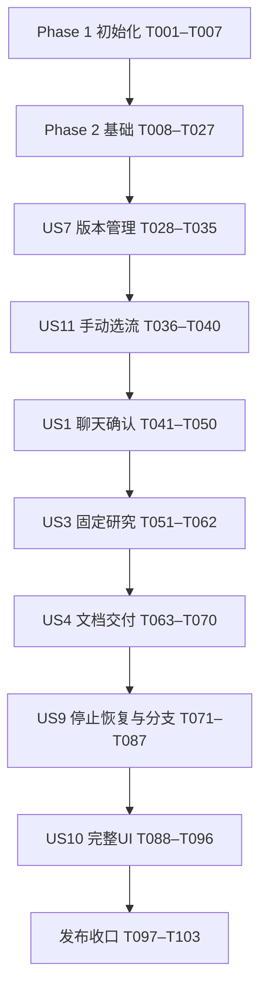

# Tasks: Personal-Agent 工作流驱动的信息研究助理（一期）

**Input**：[spec.md](spec.md)、[plan.md](plan.md)、[research.md](research.md)、[data-model.md](data-model.md)、[contracts](contracts/)、[quickstart.md](quickstart.md)。
**Created**：2026-10-19
**Scope**：用户明确只完成一期；包含 US1、US3、US4、US7、US9、US10、US11，均为 P1。US2、US5、US6、US8 及匹配、探索、沉淀、长期偏好实体/接口/页面不实施。
**Prerequisites**：阅读上述文档及 [.specify/memory/constitution.md](../../.specify/memory/constitution.md)。规划/quickstart 中“本次不生成tasks.md”描述的是先前规划阶段；本次任务生成已获用户明确请求。
**Tests**：宪章“四、自动化测试”强制要求行为变更、状态机、契约、恢复与安全验证；规格成功标准和 quickstart 已给出场景。因此纳入自动化测试任务。先编写用例并确认失败，再实现对应功能，阶段结束复跑。默认离线，真实付费调用按既定 live 条件单独进行。
**Status**：本文件仅分解工作；全部未完成，不表示已安装依赖、创建业务实现或通过测试。自定义需求清单保持原有状态；本命令不替评审者勾选。

## Format 与路径约定

- 格式为 `- [ ] TNNN [P?] [USn?] 描述及文件路径`；只有故事任务带 US 标签。
- 所有任务中的文件路径相对于仓库根 `C:/Code/spiderAgent`；业务代码统一位于 `code/`，例如 `code/backend/src/personal_agent/application/engine.py`。
- [P] 仅指同一阶段前置完成后，可与该阶段同组 [P] 项并行。它不授权跳过前置阶段，也不表示所有标记项可跨阶段同时开始。
- 未标 [P] 的任务按编号执行。实现项必须等待本阶段测试设计完成；测试编写可并行，功能验收必须等待实现。
- 每个任务采用相关设计文档中的完整字段与契约；描述逐字引用关键字段约束，不得把省略列出的普通字段删掉。新增实体时同时补迁移和持久化映射。
- 每个实现任务完成时运行最近的适用单元/契约测试；阶段末运行集成验收。若技术采用门禁失败，保留 Mock 开发路径并修订设计，真实模式不得启用。

## Phase 1: Setup — 项目初始化

**Goal**：建立可复现的 Windows 开发环境与文档基线。

**Independent Test / Checkpoint**：依赖范围可解析，三个项目入口和离线测试入口可用；候选 SDK 尚不视为已验证。

- [x] T001 核对一期范围及现有契约，补齐草稿额度追加（独立于 run 求助）、首次配置和 UI 备份恢复的请求/响应、授权及错误契约，在 specs/001-workflow-research-assistant/contracts/rest-api.md 中定义对应端点，并同步 specs/001-workflow-research-assistant/data-model.md 的关联约束；保持显式追加、不自动研究、不以用户声明替代核验，不引入二期实体。
- [x] T002 建立 Python 3.12 后端包与开发工具配置，在 code/backend/pyproject.toml 中声明 plan.md 的 FastAPI/Pydantic/SQLAlchemy/Alembic/httpx/Playwright/pytest/ruff/mypy 范围及匹配的 Harness SDK/runtime 0.2.1rc2 候选，设置 mock 默认和 live 可选依赖，创建 code/backend/src/personal_agent/__init__.py。
- [x] T003 [P] 建立 Vue 3、TypeScript 5、Vite 7、Router 4、Vitest 3 和 Playwright 项目，在 code/frontend/package.json、code/frontend/tsconfig.json、code/frontend/vite.config.ts 中配置 Node24/npm11、开发 /api 代理及 build/typecheck/test/test:e2e 入口。
- [x] T004 [P] 建立最小 TS 策略插件项目，在 code/runtime-policy/package.json、code/runtime-policy/tsconfig.json 中配置 guard/provider 挂接构建与测试入口，声明不包含业务 Loop。
- [x] T005 在 code/backend/tests/conftest.py 和 code/backend/tests/fixtures/observations.json 建立固定时钟、随机源、模型/HTTP 响应及临时工作区；默认测试阻止真实网络，live marker 必须显式启用并核对凭据和费用边界。
- [x] T006 解析依赖并生成 code/backend/uv.lock、code/frontend/package-lock.json、code/runtime-policy/package-lock.json，在 docs/dependency-baseline.md 记录 Python/Node/npm/uv、浏览器 revision 和候选 SDK 指纹；后续真实采用门禁失败保持 live 禁用，调整依赖必须重新锁定。
- [x] T007 在 .gitignore 和 .env.example 配置数据/凭据/日志排除与无秘密配置示例，在 code/scripts/check.ps1 汇总类型检查、静态检查、离线测试及策略插件测试入口；初始化 Git 仓库（main）并提交规格基线（.gitignore 与首批提交已于 2026-10-19 完成，见 origin/main `ab4229e`）。

## Phase 2: Foundational — 共享阻塞基础

**Goal**：建立显式端口、持久化、全局模型门、状态与受控产物基础；后续所有故事依赖此阶段。

**Independent Test / Checkpoint**：用固定观测验证端口、状态、事务、幂等、模型 UNKNOWN、权限和写入一致性；真实接入门禁单独记录。

- [x] T008 [P] 在 code/backend/tests/contract/test_foundation.py 编写运行时 accepted≠completed、未知输出、错误规范化、幂等键冲突、If-Match、状态事件同事务及单模型槽重启保留的失败用例。
- [x] T009 [P] 在 code/backend/tests/integration/test_managed_writes.py 编写 intent 前后、文件发布后提交前后、未知/部分/冲突与迟到结果的故障注入用例，全部使用临时目录，验证未完整保存不能成功、重复操作不重复写入。
- [x] T010 在 code/backend/src/personal_agent/domain/common.py 和 code/backend/src/personal_agent/ports/contracts.py 定义运行时、工具、仓储/UoW、渲染、时钟 DTO/协议及结构化错误；逐字落实“所有业务ID使用UUID，时间UTC RFC3339，UI以本地时区显示”“JSON列在写入和读取时按版本校验；所有可变聚合带 `revision`，更新采用CAS”，可空字段按 data-model.md 的 ? 标记，拒绝未知字段。
- [x] T011 在 code/backend/src/personal_agent/bootstrap/config.py 固定版本化政策：研究20分钟/30模型/60工具/20搜索/40页面/100000 tokens，单模型120秒/8192输出，节点3次尝试与1秒/4秒退避，HTTP10秒/30秒、浏览器30秒、收敛15秒，draft20模型/30000 tokens；保存政策hash，落实1MiB定义/64KiB事件/20MiB产物上限。
- [x] T012 在 code/backend/src/personal_agent/adapters/persistence/database.py、code/backend/src/personal_agent/adapters/persistence/uow.py 和 code/backend/alembic.ini 建立 SQLite WAL/FULL/外键/5000ms busy_timeout、独立短事务与CAS；创建 code/backend/migrations/env.py，各故事迁移按序追加，所有外键默认 RESTRICT，网络调用不持有数据库事务。
- [x] T013 在 code/backend/src/personal_agent/domain/execution.py、code/backend/src/personal_agent/adapters/persistence/execution_models.py 和 code/backend/migrations/versions/0001_execution_core.py 建立 WorkflowRun、StepRun、StepAttempt、ExecutionSlot、ExecutionEvent（后续实体引用暂存 UUID，相关实体迁移时补外键）；原文约束：“根parent为空，root=self；分支root与父一致；phase1 mode固定FIXED。版本、输入不可变；completeness=COMPLETE/PARTIAL/NO_QUALIFIED_RESULT，不能用SUCCEEDED掩盖缺口”“UNIQUE(run_id,step_id)”“UNIQUE(step_run_id,attempt_no)”“singleton_id=1”“唯一行+OS实例锁；只有收敛且无未知写入时释放；崩溃不直接把槽当空闲”“UNIQUE(owner,sequence)，provider key有值时去重；重要变更与状态同事务；无模型内部推理”；加入 data-model.md 常用索引与完整状态转换表。
- [x] T014 在 code/backend/src/personal_agent/domain/budget.py、code/backend/src/personal_agent/adapters/persistence/budget_models.py 和 code/backend/migrations/versions/0002_budget_model.py 建立 BudgetLedger、BudgetEntry、ModelRequest；逐字落实“根历史共享；预留、结算、额度追加用BudgetEntry记录；各维度非负，不以重试/分支清零”“RESERVE/SETTLE/RELEASE/GRANT；同operation同kind去重；UNKNOWN保留预留，不当零消耗”“RESERVED/IN_FLIGHT/COMPLETED/CANCELLED_CONFIRMED/UNKNOWN；全应用只有一个非终结请求；UNKNOWN不自动过期解锁”；root_run_id 或 draft_id 二选一，actual_tokens/ended_at/completion_evidence_ref 可空。
- [x] T015 在 code/backend/src/personal_agent/application/budget_service.py 实现最坏用量预留、幂等结算/释放、显式追加与有效时间计量；未知用量不按零、暂停/等待/中断不计有效时长、追加不重置重试上限，draft 和根研究分别记账并拒绝自动跨账本绕限。
- [x] T016 在 code/backend/src/personal_agent/adapters/harness/model_gateway.py 实现唯一受限模型代理及持久事务占槽，只有已配置供应商/模型路径可转发，真实密钥仅网关持有；所有澄清/生成/压缩/重试受预算和epoch检查，超时/断线/取消保留UNKNOWN与预留，仅可信完成证据解锁。
- [x] T017 在 code/backend/src/personal_agent/adapters/persistence/session_models.py 和 code/backend/migrations/versions/0003_sessions.py 建立 SessionLink，原文约束“attempt或draft二选一；provider ID允许创建未完成时为空；先存本地关联再提交任务，重复创建依operation去重”；存运行时/profile/capability指纹，补 operation_id 唯一去重记录。
- [x] T018 在 code/backend/src/personal_agent/adapters/harness/mock_runtime.py 实现同一运行时端口和可控事件/工具 Mock，覆盖 accepted、completed、failed、unknown、重复事件、迟到结果、缺失会话及兼容性错误，禁止 Mock 暗中访问真实供应商。
- [x] T019 在 code/runtime-policy/profile.json 和 code/runtime-policy/src/guard.ts 配置空工作区、官方 Loop、受限 MCP、restrict+guard；禁用 shell/fs、自动插件发现、子Agent、自修改与隐式重试，模型只能使用本地网关令牌，越权工具即使同 scope 新注册也拒绝。
- [x] T020 在 code/backend/src/personal_agent/adapters/harness/runtime.py 和 code/backend/src/personal_agent/adapters/harness/events.py 映射 capabilities/create_session/submit/events/wait_result/request_stop/reconcile/restore_session/dispose，依据实际 wheel 接口实现而非假定 cancel；白名单事件和脱敏在落盘前完成，推理仅内存，旧epoch隔离，缺失原session不冒充恢复。
- [ ] T021 在 code/backend/tests/live/test_runtime_adoption.py 和 code/runtime-policy/tests/guard.test.ts 建立并运行允许范围内的 Windows启动、wheel接口、scope越权、网关无旁路、事件脱敏、无推理持久化、UNKNOWN保持/完成解锁及会话恢复契约；结果写 docs/runtime-adoption.md。需要付费调用时仅在显式 live 授权及费用范围内运行；未运行或失败保持真实模式禁用，可继续 Mock 开发但不得发布。
- [x] T022 在 code/backend/src/personal_agent/domain/artifacts.py、code/backend/src/personal_agent/adapters/persistence/artifact_models.py 和 code/backend/migrations/versions/0004_artifacts.py 建立 SideEffectOperation、Blob、Artifact；原文约束“INTENT/NOT_APPLIED/APPLIED/PARTIAL/UNKNOWN/CONFLICT；同一逻辑效果跨分支查询；尝试ID不作唯一幂等依据；目标不接受任意客户端绝对路径”“不存任意绝对路径；immutable、同目录rename；访问必须经元数据权限与生命周期检查”“format=markdown；状态AVAILABLE/EXPIRED/DELETED/INTEGRITY_ERROR；内容组织report/checklist/comparison；下载失败不覆盖已生成成果”；按表中 ? 保留可空核验字段，建立 operations(root_run_id,logical_effect_key)、artifacts(run_id)、blobs(expires_at) 索引。
- [x] T023 在 code/backend/src/personal_agent/adapters/persistence/blob_store.py 和 code/backend/src/personal_agent/application/managed_writes.py 实现先intent、同目录临时文件flush/fsync、稳定目标发布、hash核验后同事务提交产物/状态/检查点/事件；结合目标历史核验APPLIED/NOT_APPLIED/PARTIAL/UNKNOWN/CONFLICT，跨root去重，孤儿清理不得删除合法引用文件。
- [x] T024 在 code/backend/src/personal_agent/api/middleware.py 和 code/backend/src/personal_agent/api/errors.py 实现工作区+路由+请求hash幂等、同键异请求409、If-Match缺失428/过期412、错误脱敏、稳定分页及版本化 DTO；幂等记录随关联业务生命周期保留，加入对应 code/backend/migrations/versions/0005_request_records.py。
- [x] T025 在 code/backend/src/personal_agent/api/security.py 和 code/backend/src/personal_agent/bootstrap/logging.py 实现本机引导会话、HttpOnly/SameSite、Host/Origin/CSRF、凭据受控注入、字段白名单日志及ACL自检，无账号/角色/租户；工具服务与管理接口隔离。
- [x] T026 在 code/backend/src/personal_agent/bootstrap/run.py、code/backend/src/personal_agent/bootstrap/lifespan.py 和 code/backend/src/personal_agent/api/health.py 建立 Proactor、OS单实例锁、单worker无reload、持久内部执行器、启动诊断和 /health、/policies；遗留运行只标中断不自动研究，真实模式检查接入证据，进程存活与 execution_available 分开。
- [x] T027 在 code/frontend/src/api/client.ts、code/frontend/src/router/index.ts、code/frontend/src/App.vue 和 code/frontend/src/components/SafeMarkdown.vue 建立客户端错误/ETag/幂等支持、单用户路由壳、禁止原始HTML及危险链接的Markdown展示；后续页面在各故事独立添加；并在 code/frontend/tests/unit/api-client.spec.ts 覆盖 ETag 取值与 412 处理、Idempotency-Key 生成、错误码到 UI 提示的映射。

## Phase 3: US7 — 修改流程、保留版本并默认查看最新（P1）

**Goal**：提供不可变工作流版本、校验、编辑与历史，作为选流基础。

**Independent Test / Checkpoint**：两个流程各修改保存3次；旧定义及运行引用不变，草稿不成为最新，冲突/失败保留修改（SC-007）。

### Tests → Models → Services → Interfaces → Integration

- [x] T028 [P] [US7] 在 code/backend/tests/contract/test_workflows.py 编写版本历史、空库、无变化保存、旧基线409、If-Match412、停用和不可用草稿的接口用例。
- [x] T029 [P] [US7] 在 code/backend/tests/unit/test_workflow_validation.py 编写环路/不可达/未声明依赖/条件分支错误/远程引用/权限放宽及表达式越界用例，期望定义不可发布。
- [x] T030 [US7] 在 code/backend/src/personal_agent/domain/workflows.py、code/backend/src/personal_agent/adapters/persistence/workflow_models.py 和 code/backend/migrations/versions/0006_workflows.py 建立 Workflow/WorkflowVersion 并补执行外键；逐字落实“1:N WorkflowVersion；latest必须属于自身且validated/confirmed，不从最大版本号盲推”“UNIQUE(workflow_id,version_no)；内容不可变；每次保存内容变化新版本；草稿可保存但不成为最新可执行；停用为另记状态事实”。
- [x] T031 [US7] 在 code/backend/src/personal_agent/domain/workflow_schema.py 和 code/backend/src/personal_agent/domain/workflow_validation.py 实现 contracts/workflow-schema.md 完整模型与语义校验：名称/描述/适用性非空且200/4000/4000字符、Schema深度20、步骤1—100、ID字母数字下划线1—64、表达式深度10/100子式；禁止远程ref、任意代码、未执行引用与权限放宽，校验所有正常路径到Output或显式失败及完成策略。
- [x] T032 [US7] 在 code/backend/src/personal_agent/application/workflow_registry.py 实现稳定JSON/hash、内容不变复用版本、草稿与确认可执行发布、CAS最新指针、基线冲突、停用事实，版本变更不得改变现有运行。
- [x] T033 [US7] 在 code/backend/src/personal_agent/api/workflows.py 实现 REST 契约全部 /workflows 列表、详情、versions读写及disable，返回hash/验证报告/草稿/实际版本；保存失败不伪造新版本。
- [x] T034 [US7] 在 code/frontend/src/pages/WorkflowVersionsPage.vue 和 code/frontend/src/components/WorkflowDefinitionEditor.vue 实现可读定义与JSON编辑、验证报告、显式可执行确认、历史与停用，冲突保留待保存内容，不引入可视化编排器。
- [x] T035 [US7] 在 code/frontend/tests/e2e/workflow-versions.spec.ts 验证双流程各三次保存、草稿隔离、旧编辑冲突与失败内容保留，运行 code/backend/tests/contract/test_workflows.py、code/backend/tests/unit/test_workflow_validation.py 并记录结果。

## Phase 4: US11 — 先从列表选择固定工作流（P1）

**Goal**：用户无需预先描述需求即可查看两个真实固定流程并选择。

**Independent Test / Checkpoint**：从列表读用途/范围/输入/步骤/输出，手动选择；空库与不适用明确反馈且无自动推荐（FR-030/031、SC-008）。

### Tests → Models → Services → Interfaces → Integration

- [x] T036 [P] [US11] 在 code/backend/tests/integration/test_seed_workflows.py 编写双流程定义合规、不同适用范围、各至少两方向及种子幂等用例。
- [x] T037 [P] [US11] 在 code/frontend/tests/unit/workflow-selection.spec.ts 编写无需输入即可浏览、空库、范围不适用和选择后传递准确版本的组件用例。
- [x] T038 [US11] 在 code/backend/workflows/technology-comparison.json、code/backend/workflows/public-topic-research.json 和 code/backend/src/personal_agent/bootstrap/seed.py 建立并幂等导入技术选型对比、公开主题研究定义，包含输入/方向/Agent或Tool/Transform/Condition/HumanReview/Output、预算与input_reads；只经Registry发布有效版本。
- [x] T039 [US11] 在 code/frontend/src/pages/WorkflowListPage.vue 和 code/frontend/src/pages/WorkflowDetailPage.vue 实现最新可执行列表、范围/输入/步骤/输出说明、分页及选择准确版本的路由；此阶段传递选中version，draft创建由US1提供，不自动研究。
- [x] T040 [US11] 在 code/frontend/tests/e2e/workflow-selection.spec.ts 用正常与独立临时空库验证选流、返回、停用及不适用说明；US1完成后复验聊天入口改选，运行本阶段测试。

## Phase 5: US1 — 表达并确认研究需求（P1）

**Goal**：以聊天补齐、明确建议和本次喜好，确认完整分层要求及准确版本。

**Independent Test / Checkpoint**：完整/缺失/纠正三类输入及SC-013六类确认情形；前五类不得启动，最终有效确认可交给启动接口；不依赖真实搜索。

### Tests → Models → Services → Interfaces → Integration

- [x] T041 [P] [US1] 在 code/backend/tests/contract/test_requirements.py 编写draft/messages/operations/suggestion accept/selection/confirm端点和草稿额度追加契约用例，覆盖旧revision/hash、错误版本、未接受建议及非显式授权。
- [x] T042 [P] [US1] 在 code/backend/tests/unit/test_requirement_confirmation.py 编写无特别偏好、具体取舍引导、来源区分、默认值、缺失/冲突/不适用、建议接受≠执行确认及H1/H2/H3摘要用例。
- [x] T043 [US1] 在 code/backend/src/personal_agent/domain/requirements.py、code/backend/src/personal_agent/adapters/persistence/requirement_models.py 和 code/backend/migrations/versions/0007_requirements.py 建立 RequirementDraft/ConversationMessage/Suggestion/Confirmation 并补相关外键；原文约束“status=COLLECTING/READY/CONFIRMED/STALE；字段含 value、source=user/default/suggestion、message_id、accepted_at；无特别偏好是显式值，非缺失”“UNIQUE(draft_id,sequence)；用户原话与模型摘要区分；仅聊天修改要求”“PENDING/ACCEPTED/REJECTED；接受不产生执行确认；旧revision建议不可直接应用”“action=START/BRANCH；每次确认不可变；绑定准确快照，不复用过期确认”；绑定表中全部hash、政策与版本字段，建立 runs.confirmation_id 唯一约束。
- [x] T044 [US1] 在 code/backend/src/personal_agent/application/requirement_analysis.py 通过统一Runtime/ModelGateway分析聊天，基于本次方向追问和引导具体取舍，禁止固定偏好问卷/擅自权重/长期偏好；必要字段与硬约束由确定性校验，模型建议保持待接受并记录依据。
- [x] T045 [US1] 在 code/backend/src/personal_agent/application/requirement_confirmation.py 和 code/backend/src/personal_agent/adapters/rendering/requirement_summary.py 实现完整摘要三级标题与列表、revision/hash、过期确认失效、格式协商、改选重检与显式确认；接受建议后仍需确认完整列表，不为凑标题编造要求。
- [x] T046 [US1] 在 code/backend/src/personal_agent/application/draft_operations.py 实现可持久查看的分析操作、忙时待分析、草稿独立额度求助与显式追加，不把待分析聊天自动转为研究启动，不以“知道了”授权，恢复后保持模型UNKNOWN阻塞。
- [x] T047 [US1] 在 code/backend/src/personal_agent/api/requirements.py 和 code/backend/src/personal_agent/api/operations.py 实现全部需求与操作查询契约及T001定义的草稿追加接口，BRANCH确认仅限关联proposal，缺失/冲突/版本变化返回具体错误。
- [x] T048 [US1] 在 code/frontend/src/pages/RequirementsPage.vue 和 code/frontend/src/components/RequirementSummary.vue 实现聊天、来源/建议、缺失冲突、完整摘要、版本与政策展示、建议接受及最终确认；输入修改仅走聊天，明确无特别偏好和取舍顺序。
- [x] T049 [US1] 在 code/frontend/src/components/DraftBudgetPanel.vue 实现草稿消耗、待分析/模型忙/UNKNOWN原因与额度追加反馈，确认旧摘要或改选后隐藏失效启动动作；与RequirementsPage集成；并在 code/frontend/tests/unit/draft-budget.spec.ts 覆盖草稿消耗、待分析/模型忙/UNKNOWN 原因展示及追加额度后的刷新与失效启动隐藏。
- [x] T050 [US1] 在 code/frontend/tests/e2e/requirements.spec.ts 验证SC-001输入三例、SC-006四类喜好和SC-013六类确认；用受控启动接收端确认授权边界，US3完成后复验真实 /runs，运行本阶段后端用例。

## Phase 6: US3 — 严格按流程研究信息（P1）

**Goal**：按确认版本和规则串行研究并保留方向、来源、证据及可信状态。

**Independent Test / Checkpoint**：固定观测下至少8例覆盖正常/条件/失败/版本变化/注入；无越权跳步，来源缺失如实标记（SC-003/005）。

### Tests → Models → Services → Interfaces → Integration

- [x] T051 [P] [US3] 在 code/backend/tests/unit/test_engine.py 编写六节点调度、表达式边界、必需路径、错误输出、有界重试、规则不受模型文本影响及控制决策重放用例。
- [x] T052 [P] [US3] 在 code/backend/tests/contract/test_tools.py 编写搜索/HTTP/浏览器/提取契约，覆盖scope/epoch/预算、私网与重定向、DNS rebinding、子资源、恶意页面和停止收敛。
- [x] T053 [US3] 在 code/backend/src/personal_agent/domain/research.py、code/backend/src/personal_agent/adapters/persistence/research_models.py 和 code/backend/migrations/versions/0008_research.py 建立 ResearchAction、Source、Evidence；原文约束“每个定义方向都有动作结果或缺口；参数先脱敏，外部内容标untrusted”“获取时间必填；无法确认的发布时间为空，不从获取时间推断；内容hash用于去重，不抹去不同获取时间”“classification=FACT/OPINION/INFERENCE；validity=VERIFIED/UNVERIFIED/OUTDATED/CONFLICTED；重要外部事实须来源或未证实标记”；Source的published_at/updated_at/blob_id/deleted_at可空。
- [x] T054 [US3] 在 code/backend/src/personal_agent/adapters/tools/scope.py 和 code/backend/src/personal_agent/adapters/tools/mcp_service.py 实现握手令牌、节点scope、epoch、参数Schema、停止标志和预算校验；仅受管stdio/loopback，禁止管理操作和任意脚本，域名空列表拒绝网络，URL/DNS/重定向/子资源均验证且TLS开启。
- [x] T055 [US3] 在 code/backend/src/personal_agent/adapters/tools/search.py 和 code/backend/src/personal_agent/adapters/tools/http_fetch.py 实现Brave与共享httpx适配，读取受控凭据、不自动回退抓搜索引擎，超时或受限来源返回SOURCE_UNAVAILABLE并保留来源时间/缺口。
- [x] T056 [US3] 在 code/backend/src/personal_agent/adapters/tools/browser_read.py 和 code/backend/src/personal_agent/adapters/tools/extract.py 实现按run隔离的Playwright context与纯解析提取；采用原生timeout/协作停止，不以Task.cancel伪称结束，不复用用户浏览器cookies、不绕登录/验证码，需要模型提取时显式经网关。
- [x] T057 [US3] 在 code/backend/src/personal_agent/application/research_evidence.py 实现每方向结果/缺口、来源去重与不同获取时间、冲突/过期/未证实标记、硬约束SATISFIED/VIOLATED/UNKNOWN及最终确认偏好排序，缺依据信息不进入合格推荐。
- [x] T058 [US3] 在 code/backend/src/personal_agent/application/coordinator.py 实现START确认校验、确认唯一消费、单执行槽CAS、模型未知/未收敛写入阻塞与显式启动，不自动排队切换；冻结输入/版本/配置/运行时指纹。
- [x] T059 [US3] 在 code/backend/src/personal_agent/application/engine.py 和 code/backend/src/personal_agent/domain/expressions.py 实现DAG串行调度、绑定与依赖检查、六节点派发、结构/语义验证、显式exhausted路径、SKIPPED依据、预留/结算与epoch检查；HumanReview先进入WAITING_USER，Output使用受管写入端口，专门交付实现由US4接入。
- [x] T060 [US3] 在 code/backend/src/personal_agent/api/runs.py 实现 POST/GET /runs、详情与steps快照，返回实际版本/步骤/消耗/完整程度/allowed_actions；端点不自行推进状态，只有引擎可提交StepRun。
- [x] T061 [US3] 在 code/frontend/src/pages/RunProgressPage.vue 实现真实快照的步骤、方向/来源摘要、等待原因、实际版本与资源消耗，未完成恢复操作暂不开放，US9接入后替换为服务端允许动作。
- [x] T062 [US3] 在 code/backend/tests/integration/test_fixed_research.py 验证至少8个固定观测案例及两流程的研究路径，运行本阶段单元/契约测试；Output以契约夹具独立验收调度，US4完成后复验实际文档交付。

## Phase 7: US4 — 按本次要求获得文档（P1）

**Goal**：将证据转为符合本次约定的可获取Markdown文档，完整程度真实可见。

**Independent Test / Checkpoint**：固定材料产生报告/清单/对比表和两组偏好差异；来源/缺口/未知条件清楚，下载失败后仍可重新获取（SC-005/006/008）。

### Tests → Models → Services → Interfaces → Integration

- [x] T063 [P] [US4] 在 code/backend/tests/contract/test_artifact_delivery.py 编写产物元数据/内容/410、hash/安全文件名、重复获取不重新研究和部分文档不伪报完整成功的契约用例。
- [x] T064 [P] [US4] 在 code/backend/tests/unit/test_document_rendering.py 编写三种内容结构、两组偏好、必需栏目、无合格结果、冲突/过期/未证实来源与危险链接用例。
- [x] T065 [US4] 在 code/backend/src/personal_agent/domain/document_content.py 定义目标、约束、方向结果、理由、来源、缺口及完整程度的文档契约；重要外部事实须来源或未证实标记，只有全部硬约束SATISFIED的候选可作合格推荐，排序仅用已确认priority。
- [x] T066 [US4] 在 code/backend/src/personal_agent/adapters/rendering/markdown.py 实现report/checklist/comparison渲染及约定语言/详略；如需模型组织内容只走统一运行时并再次校验，禁原始HTML/危险链接，不支持格式需执行前协商。
- [x] T067 [US4] 在 code/backend/src/personal_agent/application/artifact_service.py 接入Output与受管写入，hash验证后提交Artifact及完成程度；按completion_policy决定run状态，允许的部分交付可为SUCCEEDED但completeness必须为PARTIAL，不满足策略则保留部分文档且run为FAILED/WAITING_USER，下载重试仅追加访问事实。
- [x] T068 [US4] 在 code/backend/src/personal_agent/api/artifacts.py 实现 /runs/{id}/artifacts、/artifacts/{id}、/content，读取时检查生命周期与完整性，受控路径和脱敏错误，删除/过期410。
- [x] T069 [US4] 在 code/frontend/src/pages/ArtifactPage.vue 和 code/frontend/src/components/SourceList.vue 实现阅读/保存/再次获取、版本/来源/理由/缺口及完整程度展示，不把获取失败显示已交付。
- [x] T070 [US4] 在 code/frontend/tests/e2e/artifacts.spec.ts 验证三结构、两偏好、无合格与部分成果、获取失败重试；用 code/backend/tests/integration/test_document_checkpoint.py 验证真实Output与状态一致，并运行本阶段测试。

## Phase 8: US9 — 状态、停止、恢复、执行分支与额度求助（P1）

**Goal**：以可信状态和完整历史支持暂停/取消、原ID继续、新分支重跑及人工处置。

**Independent Test / Checkpoint**：SC-012中断与写入矩阵、SC-014六类历史、SC-015四类输入影响、SC-016七类停止/额度、SC-017六类串行情形全部可独立用固定记录验证。

### Tests → Models → Services → Interfaces → Integration

- [x] T071 [P] [US9] 在 code/backend/tests/contract/test_run_controls.py 编写pause/cancel/resume/assistance/side-effects/branch-proposals/history接口用例，包括错误状态、过期revision、重复授权及分支确认唯一性。
- [x] T072 [P] [US9] 在 code/backend/tests/integration/test_recovery.py 编写节点完成/未完成、文件已生效未记账/未生效/部分/未知/后来改动、资料过期删除、版本不兼容、cancel_requested和迟到结果的恢复用例。
- [ ] T073 [P] [US9] 在 code/backend/tests/integration/test_serial_execution.py 编写双击/跨任务/分支切换/运行中聊天/超时重试/停止仍在途六例及重启UNKNOWN，用下游请求计数证明执行分支≤1、实际模型请求≤1。
- [x] T074 [US9] 在 code/backend/src/personal_agent/domain/assistance.py、code/backend/src/personal_agent/adapters/persistence/assistance_models.py 和 code/backend/migrations/versions/0009_assistance.py 建立 AssistanceRequest、UserDecision；原文约束“kind=BUDGET_LIMIT/WRITE_RECONCILIATION/HUMAN_REVIEW/RUNTIME_UNCERTAIN；OPEN/RESOLVED/CANCELLED；必须提供实质求助信息”“聊天讨论可记录但不解除阻塞；追加额度和继续为不同显式字段；不可只凭用户声称成功跳过写入核验”；保存全部limit/consumed/步骤/问题/未知/已尝试字段，kind与status分开枚举。
- [ ] T075 [US9] 在 code/backend/src/personal_agent/domain/branches.py、code/backend/src/personal_agent/adapters/persistence/branch_models.py 和 code/backend/migrations/versions/0010_branches.py 建立 BranchProposal/ReusedResult；原文约束“DRAFT/BLOCKED/READY/CONFIRMED；确认新输入及最终起点后才创建run；影响不明标BLOCKED，不自动前移”“UNIQUE(run_id,step_id,artifact_id)；只允许起点前有效依赖成果；不是新执行的成功attempt；来源可追溯至父链”“proposal对应创建的run唯一”；原输入/hash与历史只追加。
- [x] T076 [US9] 在 code/backend/src/personal_agent/application/stop_control.py 实现停止新增行动、PAUSING/CANCELLING、draining及15秒反馈，动作收敛才终结；未知保持INTERRUPTED/cancel_requested，核验后只能完成取消，禁止迟到结果把CANCELLED改成成功。
- [x] T077 [US9] 在 code/backend/src/personal_agent/application/recovery.py 实现启动只诊断与显式resume，核验输入/定义/状态schema/runtime/profile/产物hash及时效，核验整条root写入与模型结果；原run追加新attempt/epoch/session，已成功节点不重做，不兼容或UNKNOWN不得自动解锁。
- [ ] T078 [US9] 在 code/backend/src/personal_agent/application/assistance_service.py 实现完整求助、决策记录与HumanReview结果校验；GRANT_AND_CONTINUE必须同时显式额度追加/继续且阻塞已解，DISCUSS和沉默保持等待，CHANGE_REQUIREMENTS走分支，CANCEL走取消，RECONCILE不能信任客户端APPLIED声明。
- [ ] T079 [US9] 在 code/backend/src/personal_agent/application/branch_analysis.py 实现起点存在/可达/前置核验、changed_paths+input_reads传递闭包、时效/完整性检查；影响不明或依赖缺失标BLOCKED并建议更早起点，不自动改变选择，展示失效成果和要求差异。
- [ ] T080 [US9] 在 code/backend/src/personal_agent/application/branch_service.py 实现派生draft、BRANCH确认与最终起点/report_hash绑定、parent/root和源成果引用；新run仅复用起点前有效成果、共享根预算且核验全root副作用，同proposal/confirmation不能生成多个run。
- [ ] T081 [US9] 在 code/backend/src/personal_agent/api/run_controls.py、code/backend/src/personal_agent/api/branches.py 和 code/backend/src/personal_agent/api/assistance.py 实现全部停止/恢复/分支/求助/副作用核验契约；统一返回 allowed_actions、disabled_reason、draining、在途事实及可信历史，恢复不能绕过额度求助。
- [ ] T082 [US9] 在 code/backend/src/personal_agent/api/events.py 实现提交后SSE与event-history：快照游标、Last-Event-ID、15秒心跳、默认100最大1000分页、最多1000缓冲、stream.reset、删除410；重复仅重放、不重复动作或结算，慢消费者不占长事务。
- [ ] T083 [US9] 在 code/frontend/src/api/events.ts 和 code/frontend/src/stores/run.ts 实现快照后订阅、(run_id,sequence)去重、断线补读/reset重取、迟到与draining展示；停止按钮和恢复按钮以服务端allowed_actions为准。
- [ ] T084 [US9] 在 code/frontend/src/components/RunControls.vue 和 code/frontend/src/components/AssistancePanel.vue 实现分别暂停/取消、继续前核验、额度/问题/未知/已尝试/可选处置展示及显式授权；仅讨论和未回应不自动继续。
- [ ] T085 [US9] 在 code/frontend/src/pages/ExecutionHistoryPage.vue 和 code/frontend/src/components/BranchProposalPanel.vue 实现节点/父根/分叉/源成果、选点重跑、聊天修改差异、受影响起点和双确认，不要求用户操作Git。
- [ ] T086 [US9] 在 code/frontend/tests/e2e/recovery-branches.spec.ts 覆盖两次续跑同ID、首节点/较早/再次分叉、前置不足、写入核验及四类输入影响；在 code/backend/tests/contract/test_events.py 覆盖提交顺序、重放/去重、游标清理和慢消费者；并在 code/frontend/tests/unit/event-store.spec.ts 覆盖 (run_id,sequence) 去重、断线补读、stream.reset 重取与迟到事件展示。
- [ ] T087 [US9] 在 code/frontend/tests/e2e/stop-budget-serial.spec.ts 覆盖SC-016七例和SC-017六例，运行本阶段全部用例与 foundational 写入用例，在 docs/recovery-verification.md 记录控制决策hash/版本/事件/attempt证据及未运行项。

## Phase 9: US10 — 通过完整 UI 独立完成任务（P1）

**Goal**：整合单用户真实产品链路、初始配置、数据生命周期与维护入口。

**Independent Test / Checkpoint**：初始配置后无需命令独立完成三次研究并保存文档、一次停止和失败后再发起；所有异常有原因和后续动作（SC-001/008/009、A1—A5）。

### Tests → Models → Services → Interfaces → Integration

- [ ] T088 [P] [US10] 在 code/frontend/tests/e2e/complete-journey.spec.ts 编写完整/缺失/纠正三类选流至文档案例，版本修改、停止和失败后再发起，以及空库/不适用/来源失败/模型未知/写入冲突/删除等异常界面用例。
- [ ] T089 [P] [US10] 在 code/backend/tests/integration/test_data_lifecycle.py 编写主动删除/到期、共享引用、缓存/session/日志/备份清理、墓碑、旧备份恢复不复活和不安全恢复阻断用例。
- [ ] T090 [US10] 在 code/backend/src/personal_agent/adapters/persistence/lifecycle_models.py 和 code/backend/migrations/versions/0011_lifecycle.py 建立 DeletionRecord/BackupManifest；原文约束“backup含db revision、blob hash清单、expires_at”“删除后普通查询不得读取内容；恢复先应用删除记录；共享blob在仍有合法引用时不能误删，但被删除资料不能经别的引用绕过”；记录affected_ids/requested_at/completed_at/backup_ids并与相关实体建立RESTRICT关系。
- [ ] T091 [US10] 在 code/backend/src/personal_agent/application/data_lifecycle.py 和 code/backend/src/personal_agent/api/data_items.py 实现data-items/deletions、立即访问及复用阻断、异步物理清理与操作查询；执行缓存日志7天/会话最多7天且尽快销毁/业务90天/备份7天政策，显式墓碑不保存敏感内容，失效跨分支引用。
- [ ] T092 [US10] 在 code/backend/src/personal_agent/bootstrap/backup.py 和 code/backend/src/personal_agent/bootstrap/restore.py 实现维护模式收敛、SQLite backup API及blob/hash/schema/删除清单、临时恢复验证、失败迁移恢复、版本不兼容拒绝与恢复后中断不自动续跑；不直接复制活跃主DB或破坏性downgrade。
- [ ] T093 [US10] 在 code/backend/src/personal_agent/api/settings.py 和 code/backend/src/personal_agent/api/maintenance.py 实现T001补齐的本机配置与维护接口；只返回配置健康状态不回显秘密，备份与恢复需显式操作且不得绕过未知在途，恢复前后均应用生命周期政策。
- [ ] T094 [US10] 在 code/frontend/src/pages/SetupPage.vue、code/frontend/src/pages/DataManagementPage.vue 和 code/frontend/src/pages/MaintenancePage.vue 实现配置健康、受控凭据配置、存储/授权/费用上限/保留政策、删除影响确认、备份恢复状态及原因；不要求注册或切换角色。
- [ ] T095 [US10] 在 code/frontend/src/router/index.ts、code/frontend/src/App.vue 和 code/backend/src/personal_agent/bootstrap/lifespan.py 贯通所有故事页面与生产同源静态资源，首页直接选流，真实模式仅启用已验证runtime；完整闭环不得依赖内部数据修改或二期入口。
- [ ] T096 [US10] 在 code/frontend/tests/e2e/maintenance.spec.ts 验证配置/删除/备份/恢复界面，在 code/backend/tests/integration/test_backup_restore.py 验证成功升级、迁移失败恢复与不兼容拒绝；运行本阶段完整链路及生命周期用例，记录 docs/ui-acceptance.md。

## Phase 10: Polish & Cross-Cutting — 一期发布收口

**Goal**：完成全部一期标准、安全、性能、真实接入与可复现交付；不增加二期功能。

**Independent Test / Checkpoint**：所有一期SC和A1—A5有证据；默认测试离线通过，live证据独立且不足时不得标发布完成。

- [ ] T097 [P] 在 code/backend/tests/integration/test_security_boundaries.py 覆盖网页提示注入、恶意URL/重定向/私网/子资源、路径穿越、scope越权、CSRF/Host/Origin、日志/SSE/导出/备份脱敏；修正相关模块后复跑，仅在临时工作区注入。
- [ ] T098 [P] 在 code/backend/tests/integration/test_phase1_stability.py 完成两流程×三组输入×两次共12次离线完整研究，核对文档、来源/缺口、版本和控制决策重放；用 docs/acceptance-matrix.md 汇总SC-001/003/005—009/012—017与A1—A5证据。
- [ ] T099 [P] 在 code/backend/tests/integration/test_performance.py 和 code/frontend/tests/e2e/progress-latency.spec.ts 建立10000执行记录基线，测列表/详情不含模型p95<500ms、提交事件到UI p95<1s、停止接收反馈<1s，在 docs/performance.md 记录环境、口径、结果和优化后的复验。
- [ ] T100 在 code/backend/tests/live/test_phase1_delivery.py 通过真实UI/服务链路分别运行两个流程，检查官方Loop、所有模型请求纳管、真实来源和可获取文档；仅在用户明确启用live、配置凭据并确认费用范围后执行，结果写 docs/live-acceptance.md，未运行/失败不以Mock替代。
- [ ] T101 在 code/scripts/start.ps1 和 code/scripts/package.ps1 提供安装检查、固定依赖与浏览器版本、自检、单实例生产启动和构建产物；更新 specs/001-workflow-research-assistant/quickstart.md 中目标命令为实际可用入口及状态，使用干净临时工作区验证。
- [ ] T102 运行 code/scripts/check.ps1 的全部适用检查和相关UI/策略测试，修正失败并在 docs/release-evidence.md 记录命令、结果、锁文件指纹、宪章符合性、迁移/恢复证据及未运行限制；缺陷先补失败用例，任何强制门禁未满足不得标一期完成。
- [ ] T103 在 specs/001-workflow-research-assistant/plan.md 和 docs/release-evidence.md 更新实施结果、已验证依赖与残余限制，复核所有一期故事/契约覆盖和二期排除；尊重 checklists/workflow.md 的评审者勾选权，不以实现完成自动勾选需求清单。

## Dependencies & Execution Order

### 阶段与故事依赖图

所有故事同为一期 P1，以上采用业务依赖排序，保留原故事编号，不按编号错误地让 US1 先于选流基础。独立测试指用固定契约夹具隔离上游，不表示生产功能无依赖。

| 阶段/故事 | 必需前置与衔接 |
|---|---|
| 基础 | T001–T007 完成后开始。T008/T009 可并行编写；T010–T027 依次实现。T021 的真实接入证据不足时只能通过已测 Mock 继续开发，真实模式和最终发布保持阻塞。 |
| US7 | 基础完成；校验先于发布，Registry 先于接口与编辑页面。 |
| US11 | US7 提供有效版本及列表接口；本阶段不创建RequirementDraft以避免重复建模。选中version传给US1，T050完成选流到聊天集成复验。 |
| US1 | US7+US11+统一模型门；确认仅生成授权快照。T050可用受控启动接收端独立验收，T062/T088/T096在实际启动链路再次核验。 |
| US3 | US1确认、US7固定版本、基础槽位/预算/受管写入；先工具授权再工具接入，再编排与启动。T059的HumanReview先保存WAITING_USER，US9实现其用户处置闭环。 |
| US4 | US1输出约定、US3证据、基础受管写入；T067将真实文档服务接到US3 Output并复验完成策略。 |
| US9 | US1派生draft、US3执行与US4产物；先状态模型，再停止/恢复/求助，再分支影响分析与创建；最后接SSE和UI，不提前开放尚未实现的控制操作。 |
| US10 | 全部上述故事完成，提供完整实际链路；删除与恢复贯通分支引用，T001契约先于配置/维护接口。 |
| 发布 | 所有一期故事验收通过；安全、稳定、性能可分别准备证据，真实模式必须有T021和T100结果；缺任何强制结果均不得宣告一期发布完成。 |

### 明确的跨任务依赖

- T013执行核心暂存其他聚合的UUID引用；T030、T043等对应迁移建立实体时补齐外键和唯一约束，T102检查最终不存在未落实的业务引用约束。
- T020运行时和T021接入验证依赖T016模型网关、T017会话记录、T018 Mock端口与T019策略插件；接入烟测使用受控测试工具，正式业务工具由T054–T056接入后在T100复验。
- T023受管写入只有核验完成才提交成功；US4的T067与US9的T077均必须复用该协议，不能各自实现不一致的副作用判定。
- T046草稿预算使用独立账本；T078运行求助使用根研究账本，T001需明确两种授权契约，不把未创建run的草稿强行挂到run求助接口。
- T001为阶段硬门禁：未完成则 Phase 2 及后续阶段不得开工；同时是 T041、T047、T071、T081、T093 的前置，四组契约（草稿额度追加、首次配置、备份恢复、维护）未写入 rest-api.md 前，对应接口与契约测试任务不得开始。
- T080分支创建依赖T079影响报告、T045完整要求确认、T078额度授权与T077恢复核验；新ID不得绕过任何前置。
- T082只发布已提交事件，T083消费游标和快照；事件通知失败通过重放补齐，不能重新触发业务动作。
- T092备份恢复、T093维护端点与T094维护UI依次完成，T096再做真实临时目录恢复演练。

## Parallel Examples — 每个故事的可并行示例

以下均为完成该阶段前置后的测试编写分工；不是同时运行多个业务执行或模型请求。默认离线测试仍使用固定依赖。

| 故事 | 可同时编写的任务 | 合流点 |
|---|---|---|
| US7 | T028版本接口契约；T029定义校验单元用例 | T030模型与迁移 |
| US11 | T036种子与幂等集成用例；T037选流组件用例 | T038种子定义 |
| US1 | T041需求接口契约；T042确认规则单元用例 | T043需求实体 |
| US3 | T051调度单元用例；T052工具契约用例 | T053研究实体 |
| US4 | T063产物接口契约；T064文档结构单元用例 | T065文档内容模型 |
| US9 | T071控制接口；T072恢复故障注入；T073全局串行用例 | T074求助实体 |
| US10 | T088完整链路UI用例；T089生命周期用例 | T090生命周期实体 |

初始化T003/T004可以并行建立不同项目文件；基础T008/T009可以并行编写契约与故障注入；收口T097/T098/T099可以在不同测试与证据文件开展。涉及共同迁移、公共路由、模型网关和核心状态机的修改按任务顺序合并，不能因标记并行而改同一文件。

## Requirement / Contract Coverage

| 范围 | 实施与验收任务 |
|---|---|
| FR-001/002/004；SC-001/013 | T041–T050、T058–T062、T088、T096 |
| FR-006/007/008/009；SC-003 | T051–T062、T097（注入验证）、T098 |
| FR-010/011/012；SC-005/006 | T041–T050、T057、T063–T070 |
| FR-020/021/022；SC-007 | T028–T035 |
| FR-024/025/032/033；SC-012/014/015/016/017 | T008–T026、T058–T062、T071–T087、T098 |
| FR-026；A1–A3 | T018–T021、T025、T054–T056、T063–T070、T097、T100 |
| FR-027；A4 | T022–T023、T089–T096 |
| FR-028/029；SC-008/009、A5 | 各故事页面、T025–T027、T088–T096 |
| FR-030/031 | T036–T050 |
| Workflow Definition契约 | T028–T035、T038、T051–T062 |
| Runtime/Tool/Model Gateway契约 | T008、T010、T014–T021、T052–T056、T073、T076–T077、T100 |
| REST通用/工作流/需求/运行/分支/求助/产物/SSE/删除契约 | T024–T027、T028、T033、T041、T047、T060、T063、T068、T071、T081–T083、T089、T091 |
| 数据实体与约束 | T010–T015、T017、T022、T030、T043、T053、T074–T075、T090及对应迁移 |
| 迁移、备份与恢复 | T012及各故事迁移、T092–T096、T102 |
| 工程基线与发布证据 | T006、T007、T101–T103 |
| 二期FR-003/005/013–019/023及SC-002/004/010/011 | 明确排除，不创建待办或一期发布依赖 |

## Implementation Strategy — 分步交付

1. **首个可评审增量**：完成基础 + US7 + US11 + US1（T001–T050），可手动选流、聊天澄清和确认要求。它是需求确认增量，尚不是研究助理的完整MVP。
2. **研究闭环增量**：加入US3与US4（至T070），在固定依赖下跑通研究和可保存文档；HumanReview处置及完整停止/恢复仍待US9，因此此时不作为一期发布。
3. **建议的一期MVP**：完成全部七个一期故事（至T096），包括停止、原ID续跑、分支、额度求助、串行约束和完整UI；这些是已确认的一期必需能力，不因“MVP”删减。
4. **交付门禁**：完成T097–T103并留存真实接入和真实文档证据。Mock用于独立开发与回归，不能替代真实能力发布验证。
5. **后续阶段**：二期另行规划任务，不预建其实体与页面；不因扩展接口占位引入额外平台。

## Notes

- 新增任务全部未勾选。实现任务的完成标记与需求质量清单的评审标记是不同含义。
- 模型与工具的非确定性观测需保留hash/版本/事件/attempt以复核控制决策；不保存逐字内部推理。
- 架构只允许引擎推进状态；官方Harness承担节点内Loop，不能在Python适配器或TS策略插件重写Loop。
- 实现遇到契约冲突先记录并修正文档，不私自扩展一期范围；当前38项自定义质量清单尚未由评审者逐项裁定，不能声称全部需求已审查通过。
- 此次任务生成不执行live调用、安装、迁移或发布；后续执行遵守对应任务的条件。

